# Suvilan – Complete A–Z Business & Application Flowcharts

Suvilan is a hyperlocal home services and residential community platform. This document explains the complete end-to-end working of the platform—covering every major module, user role, **Individual Booking (V1)** and **Collective Booking via Residential Groups & Service Pools (V2)**, the **Residential Group → Service Pool → Collective Booking** hierarchy, the **Service Pool to Service Provider Quotation Workflow**, the **Multi-Role Wallet & Centralized Financial Management System (V1, reused by V2)**, **Provider Negative Balance & COD Risk Controls**, database schema, dashboard capabilities, provider-defined discount slabs, payment flows, and revenue streams—along with detailed Mermaid flowcharts.

> **V1 / V2 scope:** V1 ships the individual booking and wallet system. V2 ships Residential Groups, Service Pools, and collective bookings, reusing the V1 wallet, payment, commission, refund and settlement system. V2 features must never be presented as available in V1.

> **Objective:** Understand what each user does, what Suvilan does in response, what happens next, and how every lifecycle finishes.

---

## Table of Contents

- [Platform Overview (Modules A–G)](#platform-overview-modules-ag)
- [1. Home Services Marketplace](#1-home-services-marketplace--complete-az-flow)
- [2. Group & Service Pool Booking (V2)](#2-group--service-pool-booking--complete-az-flow-v2)
- [3. Society-Wide Service Pools (V2)](#3-society-wide-service-pools--complete-az-flow-v2)
- [4. Hyperlocal Neighbour Networking](#4-hyperlocal-neighbour-networking--complete-az-flow)
- [5. Neighbourhood Business Booster](#5-neighbourhood-business-booster--complete-az-flow)
- [6. Annual Maintenance Plans](#6-annual-maintenance-plans--complete-az-flow)
- [7. Spare Parts & Materials Discovery](#7-spare-parts--materials-discovery--complete-az-flow)
- [8. Database Schema & Hierarchy](#8-database-schema--hierarchy)
- [9. User Registration, Roles & Dashboards](#9-complete-user-registration-roles--dashboards)
- [10. Suvilan Admin & Operations Flow](#10-complete-suvilan-admin--operations-flow)
- [11. Multi-Role Wallet & Centralized Financial Management System](#11-multi-role-wallet--centralized-financial-management-system)
- [12. Provider Negative Balance Limit & COD Blocking](#12-provider-negative-balance-limit--cod-blocking)
- [13. Application Navigation Structure](#13-complete-application-navigation-structure)
- [14. Business Rules to Finalise Before Development](#14-important-business-rules-that-must-be-finalised-before-development)
- [15. Recommended Development Sequence](#15-recommended-development-sequence)
- [Unified Architecture Summary](#final-understanding-how-all-suvilan-modules-connect)
- [Local Development (`suvilan-web`)](#local-development-suvilan-web)

---

## Platform Overview (Modules A–G)

Suvilan combines seven interconnected modules built on one shared platform infrastructure:

| Module                                         | Summary Flow                                                                                                                                                                                           | Primary Value                    |
| ---------------------------------------------- | ------------------------------------------------------------------------------------------------------------------------------------------------------------------------------------------------------ | -------------------------------- |
| **A. Home Services Marketplace**               | **V1:** Select Category → **Book Individually** (direct request → accept/reject/quote → choose Online Payment or Cash/COD → confirm → payment). **V2:** adds Residential Groups & Service Pools option | Core booking & commission engine |
| **B. Residential Groups & Service Pools (V2)** | Residential Group → Service Pool → Residents → Collective Quotation (provider-defined slabs) → Per-resident Online/COD → Consolidated Execution                                                        | Clustered demand & lower travel  |
| **C. Society-Wide Service Pools (V2)**         | Society announcement → Society Service Pool → Residents participate → Unified Quotation & Provider-Slab Engine → Separate per-resident Online/COD payments                                             | High-volume society orders       |
| **D. Neighbour Networking**                    | Resident verification → Community discovery → Groups/events/help requests → Interaction                                                                                                                | Engagement, trust & retention    |
| **E. Neighbourhood Business Booster**          | Business registration → Subscription → Local promotion → Customer discovery → Analytics                                                                                                                | Local merchant subscriptions     |
| **F. Annual Maintenance Plans**                | Customer purchases package → Schedule recurring services → Technician visits → Renewal                                                                                                                 | Recurring predictable revenue    |
| **G. Spare Parts & Materials Discovery**       | Technician identifies material → Nearby supplier discovery → Purchase → Potential referral revenue                                                                                                     | Supply discovery & referrals     |

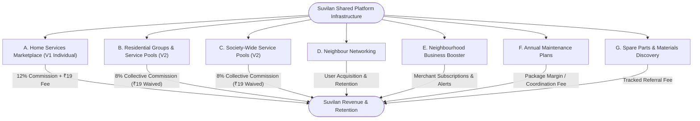

---

## 1. Home Services Marketplace – Complete A–Z Flow

This is Suvilan's primary service and initial revenue engine. There are three main participants:

- **Customer:** Wants a service at home.
- **Technician (Service Provider):** Provides the service.
- **Suvilan:** Connects both, manages booking, communication, tracking, and payment records.

### 1.1 Main Service Booking Flow (Two Booking Paths)

After selecting a service category (Plumbing, Electrical, Cleaning, AC Repair, etc.), Suvilan presents residents with **two independent booking paths**:

1. **Path A — Group-Based Booking (V2):** The resident works through the **Residential Group → Service Pool** hierarchy. They discover or join a Residential Group (Group Admin approval required), then create or join a **Service Pool** for that service, submit an individual requirement, and take part in one collective quotation. The discount comes from the **selected Service Provider's own discount slabs**, based only on **confirmed, accepted orders**.
2. **Path B — Individual Booking (V1):** The resident books directly for a single home without creating or joining any group or pool. No group discount applies.

> **Phase note:** V1 ships Path B only (individual booking, Online Payment, Cash/COD, wallets). Path A and the _Choose Booking Type_ screen's group option arrive in V2 and reuse the V1 wallet, payment, commission, refund and settlement system. V2 is never presented as available in V1.

> **Independence Rule:** A resident can use **both** paths at different times. Individual bookings never require group or pool membership and never count toward pool discounts.

> **Group ≠ Pool:** A **Residential Group** is a whole community or area (e.g., Green Residency). A **Service Pool** is a set of residents inside that group who want the same service (e.g., Plumbing Pool). Joining a pool does **not** create a confirmed order.

|                        | Path A — Group-Based (V2)                                          | Path B — Individual (V1)                          |
| ---------------------- | ------------------------------------------------------------------ | ------------------------------------------------- |
| Who books              | Residents of a Service Pool, each with their own order             | One resident for their own home                   |
| Group / pool needed    | Yes (Residential Group and Service Pool)                           | No                                                |
| Discount               | Selected provider's slabs on confirmed orders only                 | None (`0%`)                                       |
| Platform commission    | 8% of the final discounted amount                                  | 12% of the service amount                         |
| Customer platform fee  | ₹0 (waived)                                                        | ₹19, collected separately from the service amount |
| Provider sees it under | Group Service Requests                                             | Individual Booking Requests                       |
| Payment method         | Each resident chooses **Online Payment or Cash/COD** independently | Resident chooses **Online Payment or Cash/COD**   |

```mermaid
flowchart TD
    A([Resident / Customer opens Suvilan]) --> B{Logged in?}
    B -->|"No"| C["Register / Login and verify OTP"]
    B -->|"Yes"| D["Open Home Screen"]
    C --> D

    D --> E["Select Service Category<br/>Plumbing, Electrical, Cleaning, etc."]
    E --> F{Choose Booking Type}

    %% Path A: Group-Based Booking (V2)
    F -->|"Path A: Group-Based Booking (V2)"| GA["Discover existing Residential Groups in locality"]
    GA --> GB{Member of a suitable Residential Group?}
    GB -->|"Yes"| GH
    GB -->|"No, suitable group exists"| GC["Request to join the group"]
    GC --> GD{Group Admin decision}
    GD -->|"Rejected"| GE(["Request closed"])
    GD -->|"Approved"| GG["Resident becomes a Group member"]
    GB -->|"No suitable group exists"| GF["Submit new group creation request<br/>Duplicate check for the same area"]
    GF --> GG
    GG --> GH["Open Residential Group"]
    GH --> GI{Service Pool exists for this service?}
    GI -->|"Yes"| GJ["Join the Service Pool"]
    GI -->|"No"| GK["Create Service Pool<br/>Category, requirements, participation deadline,<br/>proposed date or time window<br/>Creator becomes Pool Admin"]
    GJ --> GL["Submit individual service requirement<br/>Issue, schedule, address, notes<br/>Not a confirmed order"]
    GK --> GL
    GL --> GM{"Participation deadline reached<br/>or Pool Admin taps Send to Service Provider"}
    GM --> GN["Pool Admin reviews requirements<br/>and selects one or more providers"]
    GN --> GO["Providers submit quotations<br/>using their own discount slabs"]
    GO --> GP["Pool Admin selects ONE quotation<br/>and shares it with participants"]
    GP --> GQ["Each resident independently accepts or rejects<br/>and chooses Online Payment or Cash/COD"]
    GQ --> GR["Count confirmed, accepted orders only"]
    GR --> GS["Apply selected provider's slab<br/>Final discount and final price"]
    GS --> GT{Final price higher than the price accepted?}
    GT -->|"Yes"| GU["Renewed resident acceptance required"]
    GT -->|"No"| GV
    GU --> GV["Final collective order sent to provider"]
    GV --> GW["Provider accepts, schedules and delivers"]
    GW --> GX["Each resident's service completed<br/>Separate payment per resident"]

    %% Path B: Individual Booking (V1)
    F -->|"Path B: Book Individually (V1)"| IA["Select Individual Booking"]
    IA --> IB["Select Required Service"]
    IB --> IC["Enter Service Details, Problem Description,<br/>Address and Preferred Date/Time"]
    IC --> ID["Submit Individual Request<br/>No group discount, independent of groups"]
    ID --> IE["Send Request Directly to Relevant Provider"]
    IE --> IF["Provider Reviews Request"]
    IF --> IG{Provider Action}
    IG -->|"Reject"| IH["Notify Resident, find another provider"]
    IH --> IE
    IG -->|"Accept at listed price"| IP
    IG -->|"Submit Quotation"| IJ["Resident Reviews Quotation"]
    IJ --> IK{Resident Accepts Quotation?}
    IK -->|"No"| IL(["Quotation Rejected, booking closed"])
    IK -->|"Yes"| IP["Resident chooses Online Payment or Cash/COD"]
    IP --> IQ{COD chosen and provider eligible for cash?}
    IQ -->|"COD chosen, provider blocked from COD"| IR["COD unavailable, Online Payment remains available"]
    IR --> II
    IQ -->|"Yes, or Online Payment chosen"| II["Booking Confirmed"]
    II --> IM["Service Provider Completes Service"]

    %% Shared completion
    GX --> Z
    IM --> Z["Resident confirms completion<br/>Online: payment verified in ledger<br/>COD: provider taps Collect Payment"]
    Z --> Z1["Generate Receipt, Submit Rating and Review"]
    Z1 --> Z2([Booking Completed])
```

**Discount slabs (provider-defined, illustrative):** Each Service Provider sets their own slabs, which must have no gaps and no overlaps, with inclusive bounds and an unlimited final range. For example: `1–2 confirmed jobs = 0%`, `3–4 = 5%`, `5–7 = 10%`, `8+ = 15%`. Society Admins and Group Admins cannot set or change them. Only confirmed orders count, never pool membership or interest.

### 1.2 Individual Booking Workflow (Without Joining a Group)

For residents who want direct service without participating in a group:

| Step | Actor              | Action / System Behaviour                                                                                                                                         |
| ---: | ------------------ | ----------------------------------------------------------------------------------------------------------------------------------------------------------------- |
|    1 | Resident           | Selects a service category (e.g., Plumbing, Electrical, Cleaning)                                                                                                 |
|    2 | Resident           | Chooses **Book Individually**                                                                                                                                     |
|    3 | Resident           | Selects the required specific service                                                                                                                             |
|    4 | Resident           | Enters service details, problem description, home address, and preferred date/time                                                                                |
|    5 | Suvilan            | Creates an individual service booking record (`booking_type = 'individual'`, no group/pool linkage)                                                               |
|    6 | Suvilan            | Sends the request directly to the selected/relevant service provider                                                                                              |
|    7 | Service Provider   | Reviews the individual request details on the Provider Dashboard                                                                                                  |
|    8 | Service Provider   | **Accepts** the request (fixed price), **Rejects** it, or **Submits a Quotation**                                                                                 |
|    9 | Resident           | Reviews submitted quotation (if price required determination)                                                                                                     |
|   10 | Resident           | **Accepts** or **Rejects** the quotation                                                                                                                          |
|   11 | Resident & Suvilan | Resident chooses **Online Payment** or **Cash/COD**; if Cash/COD is chosen, system checks provider's COD eligibility (if blocked, only Online Payment is offered) |
|   12 | Suvilan            | Marks the individual booking as **Confirmed** upon acceptance and payment-method selection, and notifies both parties                                             |
|   13 | Service Provider   | Visits the address and completes the service                                                                                                                      |
|   14 | Resident & Suvilan | Resident confirms completion; payment, receipt, and review follow the standard payment workflow                                                                   |

**Individual Booking & Quotation Statuses:**
`Requested` → `Pending Provider Review` → `Quoted` _(if quote needed)_ → `Confirmed` → `In Progress` → `Completed` → `Paid` _(or `Rejected` / `Cancelled` / `Expired`)_

### 1.3 Service Provider Workflow (Individual vs Group Service Requests)

The Service Provider Dashboard clearly separates **Individual Booking Requests (V1)** from **Group Service Requests (V2)** so providers can manage both pipelines without mixing pricing or discount logic:

- **Individual Booking Requests View:** Displays **Resident details**, **Service category & requested service**, **Problem description**, **Service address**, **Preferred date/time**, **COD eligibility indicator**, **Quotation & acceptance status**, and **Booking status**.
- **Group Service Requests View (V2):** Retains **group/pool participant count**, **collective quotation**, **provider-defined discount slab**, and the **collective approval & finalization workflow**.

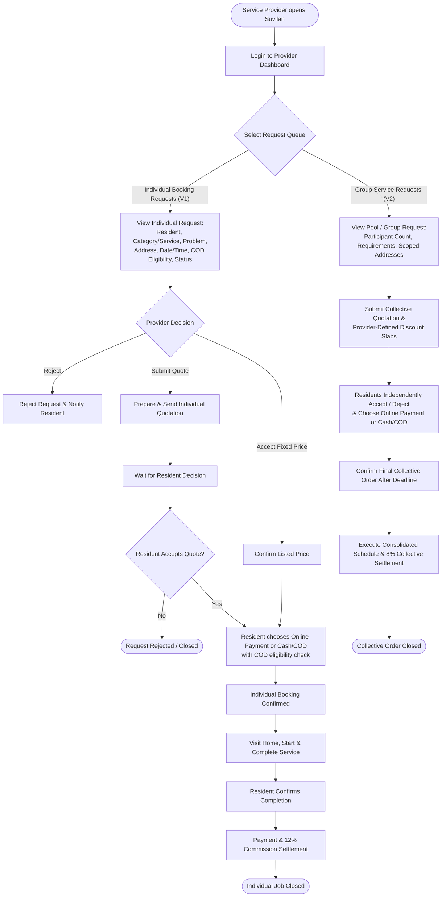

### 1.4 Payment and Suvilan Revenue Flow

All individual, collective, society-wide, and shop payments flow through Suvilan's **Centralized Transaction Ledger & Multi-Role Wallet System** (detailed in [Section 11](#11-multi-role-wallet--centralized-financial-management-system)). Two primary payment methods are supported everywhere—**Online Payment** and **Cash/COD**—with neither being mandatory (plus eligible Resident Wallet balance usage for future payments).

#### Option A – Online Payment

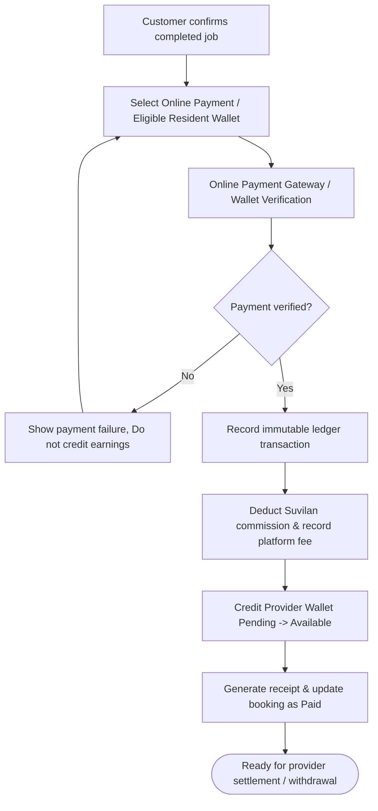

#### Option B – Cash / COD via Collect Payment (Summary)

For Cash/COD jobs, the provider collects cash physically and records it via **Collect Payment** (entering actual amount received and a variance reason if different). The central ledger records the gross transaction, commission deduction, and cash-held adjustment, then recalculates the Provider Wallet. If the configurable negative balance limit is reached, **new COD bookings are blocked (`COD Restricted`) while Online Payment bookings stay available**.

> _Authoritative COD & Collect Payment Specification:_ See [Section 11.5 (Core Payment Execution & COD Architecture)](#115-core-payment-execution--cod-architecture) for full Collect Payment, variance, partial collection, idempotency, and double-entry ledger rules, and [Section 12](#12-provider-negative-balance-limit--cod-blocking) for negative balance limits and COD restriction rules.

**Wallet & Net Payable Example (COD + Online Payment at 12% Commission):**

- Online job completed: **+₹500** gross earnings (12% commission = **-₹60**, provider earns ₹440)
- COD job completed & collected via **Collect Payment**: **+₹1,000** gross earnings (12% commission = **-₹120**)
- Total platform commission: **-₹180**
- Cash already collected physically by provider: **-₹1,000**
- **Net Payable at Settlement:** `500 + 1,000 - 180 - 1,000 = ₹320`

### 1.5 How Much Does Suvilan Earn? (Individual Booking)

| Item                                             |     Amount |
| ------------------------------------------------ | ---------: |
| Service price                                    |     ₹1,000 |
| Customer platform fee (collected separately)     |        ₹19 |
| **Customer pays**                                | **₹1,019** |
| Suvilan commission (12%)                         |       ₹120 |
| **Total gross booking-related revenue**          |   **₹139** |
| **Provider receives** (before other adjustments) |   **₹880** |

> _Note:_ ₹139 represents gross booking-related revenue, not net profit. The ₹19 customer platform fee is collected separately and never deducted from provider earnings. Payment gateway fees, refunds, customer support, and operating expenses are deducted separately.

### 1.6 Repeat Customer Booking Flow

Suppose Priya previously booked electrician Raju on Suvilan, and three months later needs another electrical repair:

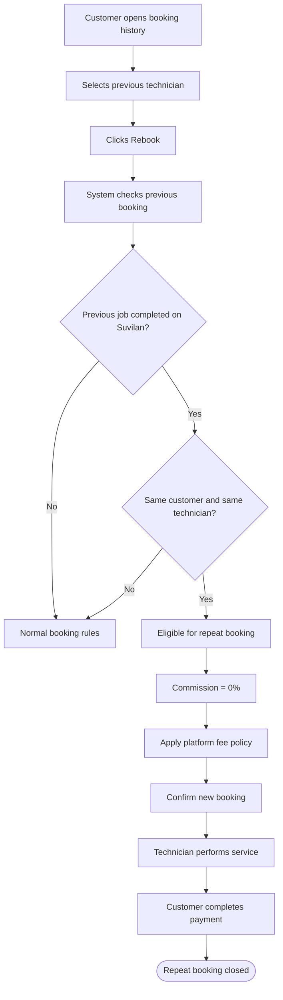

**Why Repeat Booking Matters:**

- Technician retains more earnings (0% commission).
- Customer easily rebooks a trusted professional.
- Suvilan retains both users and maintains complete service history.
- _Open policy decision:_ Whether the ₹19 customer platform fee applies to eligible repeat bookings.

---

## 2. Group & Service Pool Booking – Complete A–Z Flow (V2)

> **Release Phase:** V2. Reuses the V1 wallet, payment, commission, refund, and settlement system (no separate V2 wallet).

Suvilan organises resident collective bookings around a **Residential Group → Service Pool → Residents → Collective Booking** hierarchy:

> **Residential Group → Service Pool → Residents → Individual Requirements → Collective Quotation → Selected Quotation → Per-Resident Accept/Reject & Online/COD Choice → Provider-Slab Final Discount → Collective Booking**

For example, **Green Residency** has **ONE** permanent **Residential Group** managed by a **Group Admin**. Residents inside Green Residency can create multiple independent **Service Pools**—such as **Plumbing Pool**, **AC Repair Pool**, or **Electrical Pool**. The resident who creates a pool automatically becomes its **Pool Admin**, and other residents of Green Residency can join several pools (and leave a pool before it closes).

### 2.1 Overall Hierarchy & Group vs Pool Distinction

```text
Green Residency (Residential Group · Managed by Group Admin)
├── Plumbing Pool (Service Pool · Pool Admin: Resident A)
│   ├── Resident A (Pool Admin + Requirement)
│   ├── Resident B (Pool Member + Requirement)
│   └── Resident D (Pool Member + Requirement)
├── AC Repair Pool (Service Pool · Pool Admin: Resident C)
│   ├── Resident C (Pool Admin + Requirement)
│   ├── Resident D (Pool Member + Requirement)
│   └── Resident E (Pool Member + Requirement)
└── Electrical Pool (Service Pool · Pool Admin: ...)
```

**Residential Group vs Service Pool:**

| Entity                | What It Is                                                                                         | Creation & Discovery                                                                                                                                                        | Membership & Lifecycle                                                                                                           |
| --------------------- | -------------------------------------------------------------------------------------------------- | --------------------------------------------------------------------------------------------------------------------------------------------------------------------------- | -------------------------------------------------------------------------------------------------------------------------------- |
| **Residential Group** | A whole community or area (e.g., Green Residency, Sunrise Apartment, ABC Colony)                   | Created by a **Society Admin** or an **individual resident**; residents first discover existing groups nearby; duplicate groups in the same geographical area are prevented | Joining requires a **join request** that the **Group Admin** accepts or rejects                                                  |
| **Service Pool**      | Residents of one Residential Group who want the same service (e.g., Plumbing Pool, AC Repair Pool) | Created by an approved group member (creator defines service category, description, requirements, participation deadline, proposed date/time window)                        | Residents can join several pools and can **leave a pool before it closes**; joining a pool does **not** create a confirmed order |

**Role Distinction Inside a Residential Group & Service Pool:**

| Role                 | Scope & Responsibility                                                                                                                                                 | Restrictions                                                     |
| -------------------- | ---------------------------------------------------------------------------------------------------------------------------------------------------------------------- | ---------------------------------------------------------------- |
| **Group Admin**      | Manages the Residential Group and accepts or rejects resident join requests                                                                                            | Cannot edit or set Service Provider discount slabs               |
| **Pool Admin**       | Manages one Service Pool; sends collective quotation requests to one or more providers; selects **ONE** quotation and shares it with participants                      | Manages their own pool only; cannot edit provider discount slabs |
| **Pool Member**      | Joins one or more pools inside their group; submits individual requirements; independently accepts or rejects shared quotations and chooses Online Payment or Cash/COD | Joining or expressing interest never creates a confirmed order   |
| **Service Provider** | Configures own discount slabs per service category; submits collective quotations; accepts final collective order, schedules, and delivers services                    | Slabs are strictly controlled by the Service Provider            |

### 2.2 Complete Group & Service Pool Creation and Joining Flow

```mermaid
flowchart TD
    A(["Resident registers on Suvilan"]) --> B["Discover existing Residential Groups nearby"]
    B --> C{Suitable group exists?}
    C -->|"Yes"| D["Submit join request to Group Admin"]
    D --> E{Group Admin decision}
    E -->|"Reject"| F(["Join request rejected"])
    E -->|"Approve"| G["Resident becomes Group Member"]
    C -->|"No"| H["Submit group creation request<br/>Duplicate check in same geographical area"]
    H --> I{Duplicate group in area?}
    I -->|"Yes"| J["Prevent duplicate, direct to existing group"]
    J --> D
    I -->|"No"| K["Create Residential Group, Creator = Group Admin"]
    K --> G

    G --> L["Open Group Dashboard"]
    L --> M["View Available Service Pools"]
    M --> N{Choose Action}

    N -->|"Create Pool"| O["Select Service Category"]
    O --> P["Enter Description, Requirements,<br/>Participation Deadline & Proposed Window"]
    P --> Q["Create Service Pool Under Group<br/>Creator becomes Pool Admin"]
    Q --> R["Pool Published"]

    N -->|"Join Pool"| S["Select Existing Pool"]
    S --> T["View Pool Details"]
    T --> U["Click Join Pool"]
    U --> V["Verify Group Membership & Duplicate Check"]
    V --> W["Become Pool Member<br/>May leave pool before it closes"]

    R --> X["Other Group Residents Discover Pool"]
    W --> Y["Pool Member Dashboard"]
    X --> Y

    Y --> Z["Submit Individual Service Requirement<br/>Not a confirmed order"]
    Z --> AA["Pool Admin Sends Collective Quotation Request"]
    AA --> AB["Providers Submit Quotations Using Own Slabs"]
    AB --> AC["Pool Admin Selects ONE Quotation & Shares"]
    AC --> AD["Residents Independently Accept / Reject<br/>& Choose Online Payment or Cash/COD"]
    AD --> AE["Final Discount Calculated on Confirmed Orders Only"]
    AE --> AF["Provider Confirms Final Collective Order & Schedule"]
    AF --> AG(["Service Completed & Paid Separately"])
```

### 2.3 Step-by-Step Example (Green Residency)

1. **Step 1 – Group Discovery & Join Approval:** **Green Residency** is an existing Residential Group managed by a Group Admin. A new resident discovers Green Residency nearby, submits a join request, and the Group Admin approves it. (Had no group existed in the area, the resident would submit a group creation request with duplicate-area prevention.)
2. **Step 2 – Resident A Creates Plumbing Pool:** Resident A navigates to `Green Residency → Service Pools → Create Pool`, selects **Plumbing**, enters the description, requirements, participation deadline, and proposed date/time window, and publishes the pool. Resident A automatically becomes **Pool Admin** for the Plumbing Pool.
3. **Step 3 – Resident B Discovers and Joins:**
   - Resident B views open pools in Green Residency and clicks **Join Pool** on _Plumbing Pool_.
   - Suvilan verifies that Resident B is an approved member of Green Residency and is not already in the Plumbing Pool.
   - Resident B becomes a **Pool Member** (and may leave the pool anytime before it closes).
4. **Step 4 – Resident C Creates AC Repair Pool:** Resident C creates a separate **AC Repair Pool** under Green Residency.
5. **Step 5 – Multi-Pool Participation:** Residents can join several service pools within the same Residential Group:

| Resident   | Plumbing Pool  | AC Repair Pool |
| ---------- | -------------- | -------------- |
| Resident A | **Pool Admin** | —              |
| Resident B | Member         | —              |
| Resident C | —              | **Pool Admin** |
| Resident D | Member         | Member         |
| Resident E | —              | Member         |

> **Counting Rule:** Simply joining a pool or expressing interest does **not** create a confirmed order and does **not** count toward any discount. Only **confirmed, accepted orders** count toward the selected provider's discount slab.

### 2.4 Service Pool to Service Provider Request & Quotation Workflow

Once pool members submit their individual service requirements, Suvilan executes a structured, transparent quotation workflow between the **Pool Admin**, **Service Providers**, and **Pool Residents**:

```mermaid
flowchart TD
    A(["Members submit individual service requirements"]) --> B{"Participation deadline reached<br/>or Pool Admin taps Send to Service Provider?"}
    B -->|"Yes"| C["Pool Admin reviews requirements<br/>and sees eligible provider list"]
    C --> D["Pool Admin selects one or more providers"]
    D --> E["Send Collective Quotation Request<br/>Group, Category, Requirements, Scoped Addresses<br/>Status: Sent -> Under Review"]

    E --> F["Each Provider reviews requirements & estimated count"]
    F --> G["Provider enters itemised individual prices"]
    G --> H["Apply provider's own discount slabs for provisional discount"]
    H --> I["Submit quotation: prices, provisional discount,<br/>validity, terms & estimated schedule<br/>Status: Quoted"]

    I --> J{Quotation expired or cancelled?}
    J -->|"Yes"| K(["Status: Expired / Rejected"])
    J -->|"No"| L["Pool Admin reviews all quotes & selects ONE quotation"]
    L --> M["Pool Admin shares selected quotation with participants"]

    M --> N["Each resident independently reviews individual quote"]
    N --> O{Resident decision}
    O -->|"Rejects"| P["Resident order excluded<br/>Status: Rejected"]
    O -->|"Accepts"| Q["Resident chooses Online Payment or Cash/COD<br/>with COD eligibility check if COD<br/>Status: Accepted"]

    Q --> R["Acceptance deadline reached"]
    R --> S["Count ONLY confirmed, accepted orders"]
    S --> T["Match confirmed count to selected provider's discount slab"]
    T --> U["Compute final discount & final payable per order"]

    U --> V{Final price > previously accepted price?}
    V -->|"Yes"| W["Do NOT silently increase price!<br/>Require renewed resident acceptance"]
    W --> X{Resident re-confirms?}
    X -->|"No"| XA["Resident order excluded<br/>Status: Rejected"]
    XA -->|"Recalculate count & price"| S
    X -->|"Yes"| Y["Lock remaining orders"]
    V -->|"No"| Y

    Y --> Z{Minimum order threshold / pool valid?}
    Z -->|"No"| AA["Cancel or renegotiate per pool policy"]
    Z -->|"Yes"| AB["Send final collective order to selected provider"]
    AB --> AC{Provider accepts final collective order?}
    AC -->|"No"| AA
    AC -->|"Yes"| AD["Status: Finalized<br/>Create individual bookings & consolidated schedule"]
    AD --> AE(["Proceed to service delivery"])
```

#### Detailed 5-Stage Breakdown

1. **Trigger & Collective Quotation Request:**
   - After the participation deadline, **or earlier when the Pool Admin taps Send to Service Provider**, the Pool Admin reviews all submitted requirements (`pool_service_requests`) and sees the provider list.
   - The Pool Admin sends a collective quotation request (`quotation_requests`) to **one or more** service providers, including group, service category, individual requirements, and privacy-scoped service addresses.
2. **Providers Review & Submit Quotations:**
   - Each selected provider reviews requested services and estimated order count, enters itemised individual pricing, and applies their **own configured discount slabs** (`provider_discount_slabs`) to calculate a **provisional discount**.
   - Providers submit quotations containing itemised pricing, provisional discount, validity period, terms, and estimated service schedule (`Quoted`).
3. **Pool Admin Selects ONE Quotation & Residents Decide:**
   - The Pool Admin selects **ONE** quotation and shares it with the pool participants.
   - Each resident **independently accepts or rejects** their own individual service quotation, and chooses **Online Payment** or **Cash/COD** (with COD eligibility check if Cash/COD is chosen).
   - **Only confirmed, accepted orders** count toward the final discount calculation.
4. **Final Discount Calculation & Price-Protection Rule:**
   - At the acceptance deadline, Suvilan counts only confirmed, accepted orders, matches the count against the selected provider's discount slabs, and computes the final discount and final payable per order.
   - **Price-Protection Rule:** Suvilan must **never silently raise** a resident's payable amount. If the final price is higher than the price a resident accepted (for example, if fewer residents confirmed than estimated), **renewed resident acceptance is mandatory** before locking that order.
5. **Final Collective Order Confirmation:**
   - The final collective order goes to the selected provider (`Finalized`), who accepts, schedules, and delivers the services.

#### Quotation Lifecycle Statuses

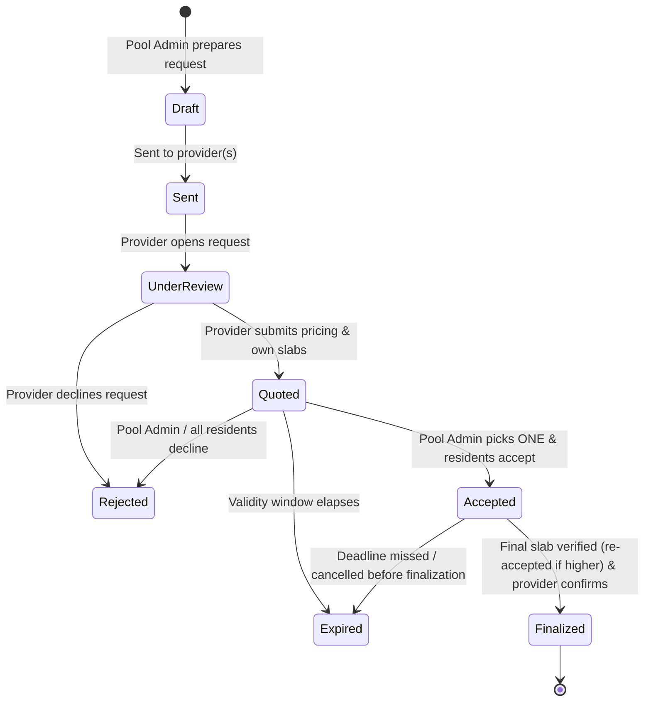

### 2.5 Provider-Defined Discount Slabs & Worked Example

- **Individual Bookings (V1):** Must **not** receive pool discounts (`0%`) and must **not** be counted toward any pool's confirmed order count.
- **Provider-Defined Slabs (V2):** Discount slabs belong strictly to the **Service Provider** per service category. **Society Admins and Group Admins cannot set or change them.** There are **no platform-fixed discount tiers**.
- **Validation Rules (enforced whenever a provider creates or updates slabs):**
  - No gaps and no overlaps between ranges.
  - Every confirmed-order count falls into **exactly one** slab.
  - Inclusive minimum and maximum bounds, with an **unlimited final slab** (e.g., `8+`).
- **Confirmed Jobs Rule:** The number of **confirmed, accepted jobs** decides the slab, never the size of the Residential Group or Service Pool.

**Illustrative Provider Discount Slabs (percentages are illustrative; each provider sets their own):**

| Confirmed Jobs | Illustrative Discount |
| -------------- | --------------------: |
| 1–2            |                    0% |
| 3–4            |                    5% |
| 5–7            |                   10% |
| 8+             |                   15% |

**Worked Example (Provisional 9 Interested → 6 Confirmed):**

- Normal plumbing price per home: **₹1,000**
- Initially **9** residents submit requirements → provisional slab (`8+` = **15%**) quotes **₹850** per home.
- At acceptance, **6** residents confirm and accept (3 reject or do not respond).
- **6 confirmed jobs** falls in the provider's `5–7` slab (**10% discount**):

$$\text{Discount} = 1000 \times \frac{10}{100} = ₹100$$

$$\text{Final Price per Home} = 1000 - 100 = ₹900$$

- **Price-Protection Triggered:** Because **₹900 > ₹850** (the price residents accepted), Suvilan **requires renewed resident acceptance** for ₹900—never silently raising the payable amount. All 6 residents re-confirm at ₹900.

| Metric                             |       Value |
| ---------------------------------- | ----------: |
| Original price per home            |      ₹1,000 |
| Final discount per home (5–7 slab) | -₹100 (10%) |
| Final price per household          |    **₹900** |
| Number of confirmed customers      |           6 |
| **Total discounted service value** |  **₹5,400** |

### 2.6 Actual Service Execution Flow

Once finalized, the provider receives one consolidated schedule for the pool, while each household has its own individual booking, payment method choice (**Online Payment** or **Cash/COD**), payment record, and receipt. Residents in one pool may choose different payment methods, and each resident's payment and transaction stay strictly separate.

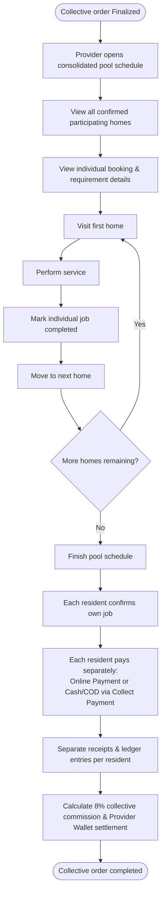

### 2.7 Revenue from Collective Pool Bookings

Every collective booking incurs an **8% platform commission** on the **final discounted amount**, and the **₹19 customer platform fee is waived** (`₹0`). There is **no minimum unit count** required for the 8% rate.

| Item                                             | Calculation |
| ------------------------------------------------ | ----------: |
| Confirmed participating homes                    |           6 |
| Normal price per home                            |      ₹1,000 |
| Final provider-slab discount (10%)               |       -₹100 |
| Final discounted price per home                  |        ₹900 |
| Customer platform fee                            | ₹0 (waived) |
| Total discounted service value                   |      ₹5,400 |
| Suvilan collective commission (8%)               |    **₹432** |
| **Provider receives** (before other adjustments) |  **₹4,968** |

> **Transparency Rule:** Discounts are funded by the service provider through their own configured discount slabs, never silently subsidised by Suvilan. The UI must clearly display the original price, provisional vs. final discount, commission, and provider payout.

---

## 3. Society-Wide Service Pools – Complete A–Z Flow (V2)

Unlike resident-created service pools (started by any approved member inside a Residential Group), **society-wide service pools** are coordinated at the housing society level by the **Society Admin** on top of the Residential Group, using the **exact same unified pool, quotation, and provider-slab engine**.

### 3.1 Resident Service Pool vs Society-Wide Service Pool

| Resident Service Pool                               | Society-Wide Service Pool                                    |
| --------------------------------------------------- | ------------------------------------------------------------ |
| Started by any group resident (becomes Pool Admin)  | Initiated by Society Admin via society announcement          |
| Can target a small cluster or whole building        | Usually broader society-wide participation                   |
| Discovered in Group Dashboard / shared inside group | Broadcast via Society-Wide Announcement & notifications      |
| Uses unified quotation & provider-slab engine       | Uses the exact same unified quotation & provider-slab engine |
| Only confirmed accepted requests count              | Only confirmed accepted units count                          |

### 3.2 Society & Residential Group Creation Flow

A Residential Group can be created by a **Society Admin** or an **individual resident**, always with duplicate-area prevention and verification checks (never bypassing the R2 group checks).

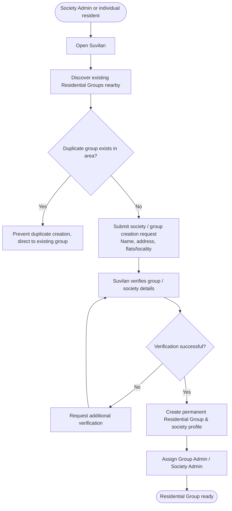

_Example:_ **Green Residency** registers with **180 flats**.

### 3.3 Society-Wide Service Pool Flow (Unified Quotation Engine)

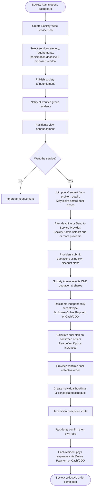

### 3.4 Discount Logic (Provider-Defined Slabs)

Society-wide service pools do **not** have separate fixed discount tiers. They use the **exact same provider-defined discount slab engine** (see [Section 2.5](#25-provider-defined-discount-slabs--worked-example)), where the Service Provider sets their own slabs per category and only **confirmed, accepted orders** count.

### 3.5 Example: AC Servicing in Green Residency

- Normal AC servicing price: **₹1,000**
- Confirmed participating flats: **10**
- Using the illustrative provider slab (`8+ confirmed jobs` = **15%**):

$$\text{Discounted Price per Flat} = 1000 - (1000 \times 15\%) = ₹850$$

| Particular                                 |      Amount |
| ------------------------------------------ | ----------: |
| Confirmed participating flats              |          10 |
| Normal total price                         |     ₹10,000 |
| Total provider-slab discount (15%)         |     -₹1,500 |
| Discounted service value                   |      ₹8,500 |
| Customer platform fee                      | ₹0 (waived) |
| **Suvilan collective commission (8%)**     |    **₹680** |
| **Provider receives** (before adjustments) |  **₹7,820** |

The technician services all 10 flats over two days in one society instead of travelling to 10 separate neighbourhoods.

### 3.6 Society Payment & Reconciliation Flow

Each household in a society-wide pool chooses its own payment method independently (**Online Payment** or **Cash/COD**), and each resident's payment and transaction stay strictly separate. There is **no central society payment** arrangement.

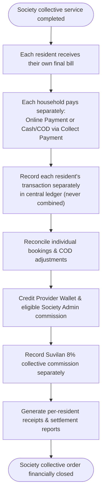

> _Implementation Note:_ Society Admin wallets receive only eligible configured Society Admin commissions/incentives—never the full value of service bookings, and never central payments on behalf of households.

---

## 4. Hyperlocal Neighbour Networking – Complete A–Z Flow

This module connects people living in the same society or nearby radius. Its primary objective is **community building, daily engagement, and retention** rather than direct commission.

### 4.1 Resident Registration & Discovery Setup Flow

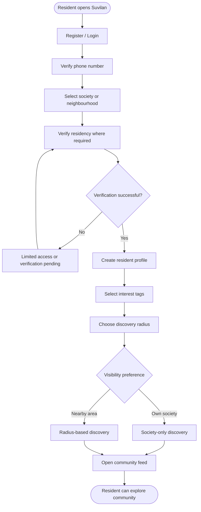

### 4.2 Community Interaction Flow

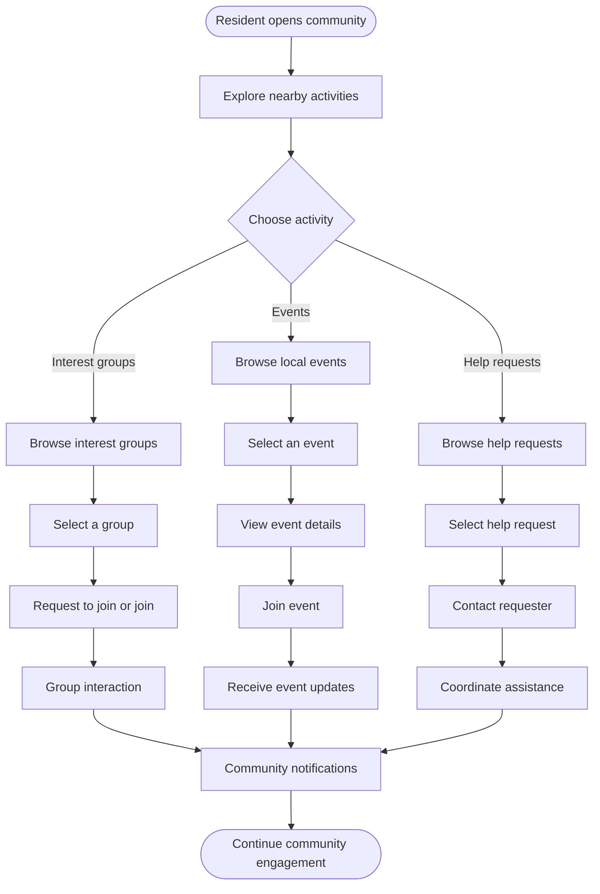

**Examples of Community Activities:**

- **Morning running group:** Daily neighbour fitness runs.
- **Book club:** Book sharing and local reading meetups.
- **Society sports day:** Local tournaments and cultural gatherings.
- **Blood donation request:** Urgent volunteer coordination.

### 4.3 Safety & Moderation Flow

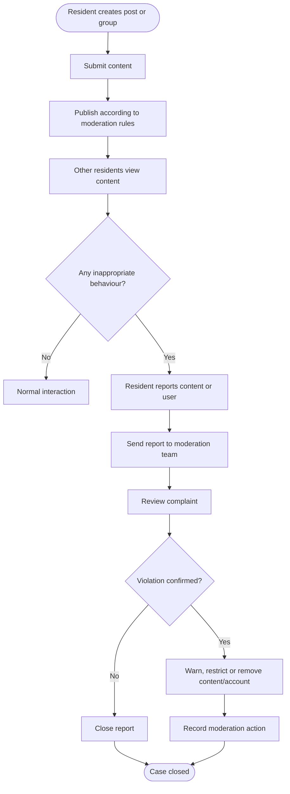

**Core Safety Features:**

- Phone / ID verification badges
- Block and report controls
- Published community guidelines
- Moderation queue and audit logs

### 4.4 How Suvilan Benefits (Indirect Value)

> **No direct revenue at launch.**

Neighbour networking drives:

1. Organic resident acquisition.
2. Hyperlocal trust and verified identity.
3. Higher app open frequency and engagement.
4. Cross-discovery of home services, service pools, and local businesses.
5. Repeat bookings (e.g., a resident joins a running club, discovers a Green Residency Plumbing Pool, and books a service).

---

## 5. Neighbourhood Business Booster – Complete A–Z Flow

Helps local shops and neighbourhood businesses (grocery stores, bakeries, salons, hardware shops, stationery stores, restaurants) reach residents living nearby through paid visibility and radius-based alerts.

### 5.1 Business Registration Flow

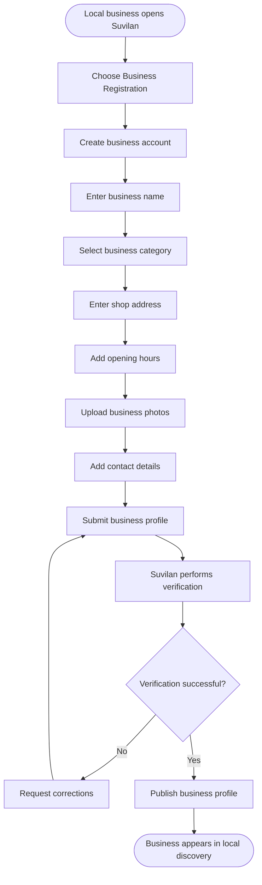

### 5.2 Business Subscription Plans (Proposed Pricing)

| Plan / Add-on          |        Price | Included Benefits                                                     |
| ---------------------- | -----------: | --------------------------------------------------------------------- |
| **Basic**              |         Free | Business profile + 1 alert within 1 km radius                         |
| **Plus**               | ₹299 / month | 3 km radius + 2 alerts/month                                          |
| **Business Pro**       | ₹799 / month | 5 km radius + 4 alerts/month + promoted placement + follower insights |
| **Grand Opening Pack** |         ₹499 | Launch visibility boost                                               |
| **Single Boost**       |  ₹99 / alert | One-off promotional alert                                             |

### 5.3 Business Promotion & Discovery Flow

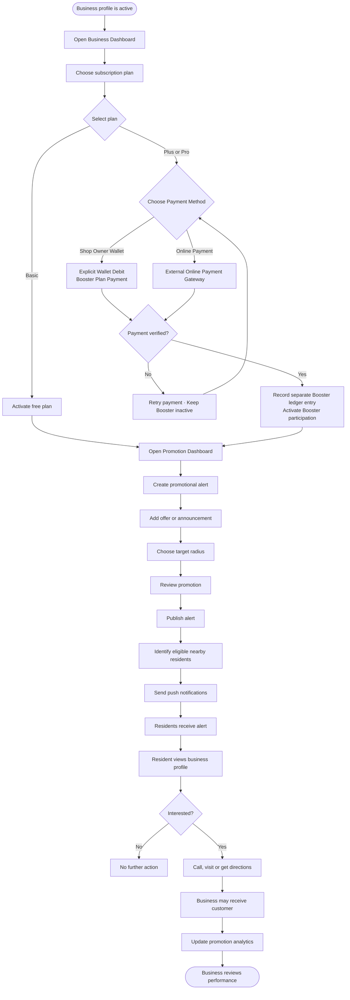

**What the Business Sees:** Measurable reach and engagement (profile views, followers, alert reach, direction/call clicks)—without guaranteeing a fixed number of purchases.

### 5.4 Subscription Revenue & Renewal Flow

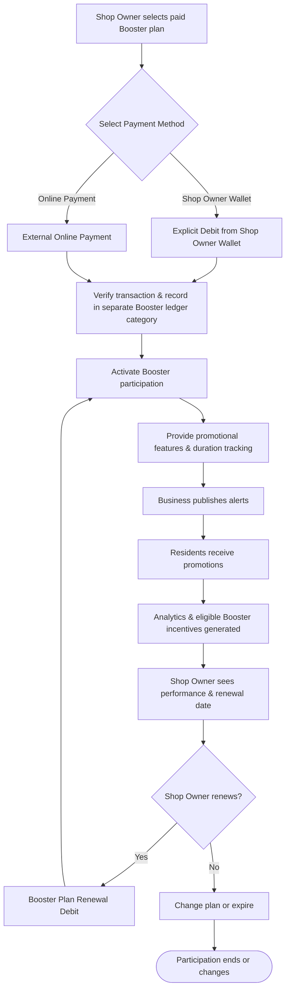

> **Strict Booster Separation Rule:** Booster fees are promotional participation expenses—not shop earnings and not platform service commission. Booster fees must **never** be automatically deducted from shop order sales; they are debited from the Shop Owner Wallet only when the Shop Owner explicitly selects wallet payment.

---

## 6. Annual Maintenance Plans – Complete A–Z Flow

Designed to generate predictable recurring revenue instead of relying purely on one-off bookings. Customers buy an annual package covering scheduled visits and priority support (e.g., **Annual AC Care Package**: 2 scheduled servicing visits, priority repair booking, technician coordination, and defined exclusions).

### 6.1 Customer Purchase Flow

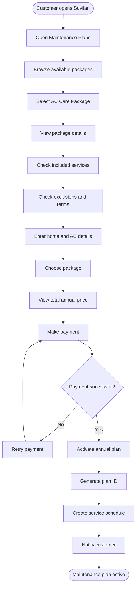

### 6.2 Recurring Service Execution & Renewal Flow

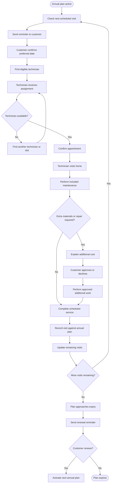

### 6.3 Revenue Model

Suvilan collects the annual package payment upfront, coordinates recurring visits, settles agreed technician payouts per visit, and retains the agreed margin or coordination fee. Package pricing, exclusions, spare-part billing, and cancellation/refund terms must be explicitly defined prior to launch.

---

## 7. Spare Parts & Materials Discovery – Complete A–Z Flow

Connects technicians and customers with nearby hardware/spare-parts suppliers. **Suvilan does not purchase, own, or store inventory**—it acts strictly as a local discovery and tracked referral layer.

### 7.1 Example Scenario

A customer books a plumber for a leaking tap. During inspection, the plumber finds that the tap cartridge needs replacement and searches Suvilan for nearby hardware suppliers carrying the part.

### 7.2 Technician / Customer Discovery Flow

```mermaid
flowchart TD
    A([Technician visits customer]) --> B[Inspects the problem]
    B --> C{Spare part required?}
    C -->|No| D[Complete normal service]
    C -->|Yes| E[Identify required material]
    E --> F[Open Suvilan supplier discovery]
    F --> G[Search nearby shops]
    G --> H[View supplier profiles]
    H --> I[Compare available products and details]
    I --> J[Select suitable supplier]
    J --> K[Contact supplier or send inquiry]
    K --> L{Product available?}
    L -->|No| M[Search another supplier]
    M --> G
    L -->|Yes| N[Customer or technician purchases material]
    N --> O[Supplier fulfils order]
    O --> P[Continue or complete repair]
    P --> Q([Service completed])
```

### 7.3 Supplier-Side Flow

```mermaid
flowchart TD
    A([Supplier joins Suvilan]) --> B[Create merchant profile]
    B --> C[Add shop information]
    C --> D[Add product catalogue]
    D --> E[Publish available products]
    E --> F[Nearby technician or customer searches]
    F --> G[Views supplier listing]
    G --> H[Sends product inquiry]
    H --> I[Supplier receives inquiry]
    I --> J[Supplier confirms availability]
    J --> K[Customer or technician purchases]
    K --> L[Supplier fulfils order]
    L --> M[Record tracked transaction]
    M --> N([Potential referral revenue])
```

### 7.4 Revenue Example (Illustrative)

| Particular                   |   Amount |
| ---------------------------- | -------: |
| Material purchase            |   ₹2,000 |
| Illustrative referral rate   |       5% |
| **Suvilan referral revenue** | **₹100** |

> _Note:_ 5% is illustrative only; referral rates require formal supplier agreement.

---

## 8. Database Schema & Hierarchy

The database models the permanent residential group hierarchy alongside the unified service-pool quotation and discount engine.

```mermaid
erDiagram
    residential_groups ||--o{ group_creation_requests : "requested via"
    residential_groups ||--o{ group_join_requests : "receives"
    residential_groups ||--o{ group_members : "has"
    residential_groups ||--o{ service_pools : "hosts"
    group_members ||--o{ service_pools : "creates (Pool Admin)"
    service_pools ||--o{ pool_members : "contains"
    group_members ||--o{ pool_members : "joins as"
    service_pools ||--o{ pool_service_requests : "collects"
    pool_members ||--o{ pool_service_requests : "submits"

    service_pools ||--o{ quotation_requests : "issues"
    quotation_requests ||--o{ provider_quotations : "receives"
    service_pools ||--o| provider_quotations : "selects ONE (selected_quotation_id)"
    provider_quotations ||--o{ quotation_item_prices : "details"
    pool_service_requests ||--o{ quotation_item_prices : "priced in"
    provider_quotations ||--o{ resident_quote_responses : "reviewed via"
    pool_members ||--o{ resident_quote_responses : "accepts/rejects"
    service_providers ||--o{ provider_discount_slabs : "configures"
    provider_quotations ||--o| collective_orders : "finalizes into"
    collective_orders ||--o{ bookings : "generates"

    wallets ||--o{ ledger_transactions : "records"
    bookings ||--o{ ledger_transactions : "settles via"
    bookings ||--o| cod_collections : "tracks COD"
    bookings ||--o{ refunds : "refunds via"
    wallets ||--o{ settlement_withdrawals : "pays out"
    wallets ||--o{ booster_subscriptions : "funds (optional)"
    service_providers ||--o| provider_risk_limits : "governed by"
```

### Core Group, Pool, Quotation & Financial Tables

| Table                        | Responsibility                                                                                                                                                                                                                                                                                                                                  |
| ---------------------------- | ----------------------------------------------------------------------------------------------------------------------------------------------------------------------------------------------------------------------------------------------------------------------------------------------------------------------------------------------- |
| `residential_groups`         | Stores permanent Residential Groups (e.g., Green Residency) with a **duplicate-area uniqueness rule** preventing duplicate groups in the same geographical area                                                                                                                                                                                 |
| `group_creation_requests`    | Tracks resident or Society Admin requests to create a new Residential Group (`status`, duplicate-area verification, `decided_by`, `decided_at`)                                                                                                                                                                                                 |
| `group_join_requests`        | Tracks resident requests to join an existing Residential Group (`status`: `Pending` / `Approved` / `Rejected`, `decided_by` Group Admin, `decided_at`)                                                                                                                                                                                          |
| `group_members`              | Verified residents belonging to a Residential Group and their group role (`group_admin` / `resident`)                                                                                                                                                                                                                                           |
| `service_pools`              | Service-specific pools under a `group_id` (resident-created or Society Admin-created), storing `description`, `requirements`, `participation_deadline`, `proposed_window`, `status`, and `selected_quotation_id` (exactly ONE selected quotation)                                                                                               |
| `pool_members`               | Residents belonging to each pool (`pool_admin` or `member`) with `status` (`joined` / `left`), referencing a valid `group_member`                                                                                                                                                                                                               |
| `pool_service_requests`      | Individual service requirements, scoped address, problem details, and preferred window per resident                                                                                                                                                                                                                                             |
| `provider_discount_slabs`    | Service Provider's configured confirmed-job ranges (`min_jobs`, `max_jobs` or unlimited) and discount percentages per category                                                                                                                                                                                                                  |
| `quotation_requests`         | Collective quotation requests sent by Pool Admin / Society Admin to one or more service providers (`Draft`, `Sent`, `Under Review`, etc.)                                                                                                                                                                                                       |
| `provider_quotations`        | Provider's submitted quotation with provisional discount, validity period, terms, estimated schedule, and lifecycle status                                                                                                                                                                                                                      |
| `quotation_item_prices`      | Itemised original service price per `pool_service_request` inside a quotation                                                                                                                                                                                                                                                                   |
| `resident_quote_responses`   | Independent resident acceptance/rejection (`Accepted`, `Rejected`, `Reconfirmation Required`), tracking `accepted_payable_amount` and per-order `payment_method` (`Online Payment` / `Cash/COD`)                                                                                                                                                |
| `collective_orders`          | Finalized collective order record after acceptance calculation, final provider-slab discount application, and provider confirmation                                                                                                                                                                                                             |
| `bookings`                   | Distinguishes `booking_type` (`'individual'` vs `'collective'`). Individual bookings store `service_pool_id = NULL`, `collective_order_id = NULL`, `discount_percent = 0`, and link directly to the resident, provider, and optional individual quotation; collective bookings link to `collective_orders` and store per-order `payment_method` |
| `wallets`                    | Role-scoped wallets (`resident`, `service_provider`, `society_admin`, `shop_owner`, `platform_admin`) tracking `current_balance`, `available_balance`, `pending_balance`, `total_credits`, `total_debits`, and `financial_status`                                                                                                               |
| `ledger_transactions`        | Immutable double-entry financial ledger (`transaction_id`, `wallet_id`, `user_id`, `user_role`, `related_order_id`, `transaction_type`, `credit_amount`, `debit_amount`, `payment_method`, `status`, `description`, `created_at`, `reference_transaction_id`)                                                                                   |
| `cod_collections`            | Tracks Cash/COD **Collect Payment** confirmations (`collector_id`, `beneficiary_id`, `gross_amount`, `amount_collected`, `outstanding_amount`, `variance_reason`, `review_flag`, `collection_status`, `collected_at`) with idempotency keys                                                                                                     |
| `refunds`                    | Tracks service booking, shop order, and eligible Booster refunds (`refund_target`: `wallet` or `original_payment_method`), preventing duplicate credits                                                                                                                                                                                         |
| `settlement_withdrawals`     | Tracks withdrawal requests & scheduled payouts for Service Providers, Society Admins, and Shop Owners (`Pending`, `Completed`, `Failed`)                                                                                                                                                                                                        |
| `booster_subscriptions`      | Tracks Neighbourhood Business Booster plan participation, duration, renewal date, and separate Booster payment/incentive/refund references                                                                                                                                                                                                      |
| `provider_risk_limits`       | Stores configurable negative balance limits (default or provider-specific), warning thresholds, `financial_status`, `operational_status` (`Active`, `Warning`, `COD Restricted`, `Manually Blocked`, `Suspended`), and `cod_eligible` flag                                                                                                      |
| `admin_financial_audit_logs` | Records every manual admin financial adjustment, limit change, and block/unblock action (`admin_id`, `reason`, `timestamp`, `previous_state`, `new_state`)                                                                                                                                                                                      |

**Important Database Integrity Rules:**

- Every `service_pools` record **must** reference a valid `group_id` (`residential_groups.id`) and enforce at most **one** `selected_quotation_id`.
- `residential_groups` must enforce a **duplicate-area uniqueness rule** preventing duplicate groups in the same geographical area.
- A pool's creator (`Pool Admin`) **must** already be an approved member in `group_members` for that `group_id`.
- Every `pool_members` record **must** reference a valid `group_member` belonging to the pool's `group_id`.
- **Provider Discount Slab Validation:** Whenever a provider creates or updates `provider_discount_slabs`, the system must validate that there are **no gaps and no overlaps**, every confirmed-order count falls in **exactly one slab**, bounds are inclusive, and the final slab is unlimited. Society Admins and Group Admins cannot set or edit slabs.
- **Individual Booking Independence:** Individual bookings (`booking_type = 'individual'`) must **not** require `group_members` or `pool_members` records, always have `discount_percent = 0`, and are **never** included when counting confirmed collective participants.
- Pool membership (`pool_members`) and submitted requests (`pool_service_requests`) do **not** count as confirmed orders—only `resident_quote_responses` in an accepted/reconfirmed state count toward final discount calculation.
- `resident_quote_responses` stores the exact `accepted_payable_amount` so Suvilan can enforce re-confirmation if the final calculated amount increases or differs.
- **Immutable Financial Ledger Rule:** Wallet balances must **never** be modified directly without writing an atomic, idempotent entry in `ledger_transactions`; corrections must use reversal or adjustment entries referencing `reference_transaction_id`.

---

## 9. Complete User Registration, Roles & Dashboards

Suvilan supports four primary external user roles (plus internal Suvilan Admin):

1. **Customer / Resident** — Books services, joins residential groups, creates/joins service pools, reviews quotations, joins society bulk pools, and uses community features.
2. **Technician / Service Provider** — Provides individual & bulk services, configures discount slabs, reviews bulk quotation requests, submits itemised quotations, manages consolidated schedules, and tracks earnings/wallet.
3. **Merchant / Supplier** — Lists spare-part products, responds to material inquiries, and runs Business Booster promotions.
4. **Society Admin / Group Admin** — Registers societies, manages permanent residential groups, publishes society-wide bulk announcements/pools, and coordinates society payments.

### 9.1 Registration & Verification Flow

```mermaid
flowchart TD
    A([User opens Suvilan]) --> B[Register / Login]
    B --> C[Verify mobile using OTP]
    C --> D[Create user account]
    D --> E[Choose account type]

    E -->|Customer / Resident| F[Complete resident profile & join residential group]
    E -->|Technician / Provider| G[Complete provider profile & discount slabs]
    E -->|Merchant / Supplier| H[Complete business profile]
    E -->|Society Admin| I[Submit society information]

    F --> J[Activate resident account]
    G --> K[Provider KYC and verification]
    H --> L[Merchant verification]
    I --> M[Society verification]

    K --> N{Approved?}
    L --> O{Approved?}
    M --> P{Approved?}

    N -->|Yes| Q[Activate service provider dashboard]
    N -->|No| R[Request corrections]
    O -->|Yes| S[Activate merchant dashboard]
    O -->|No| R
    P -->|Yes| T[Activate society/group admin dashboard]
    P -->|No| R

    J --> U([Account active])
    Q --> U
    S --> U
    T --> U
```

### 9.2 Role-Specific Dashboards for Individual & Collective Pool Bookings

- **Resident Application:**
  - Choose between **Book Individually (V1)** (direct service request with `0%` group discount, no group required) or **Group-Based Booking (V2)** (under a Residential Group such as Green Residency) at any time.
  - Create a new Service Pool (auto-assigned **Pool Admin**) or join multiple pools as a **Pool Member** (and leave before a pool closes).
  - Submit individual service requirements (`Pool Member Dashboard`) or direct individual service requests.
  - Review shared provider quotations (collective or individual), independently **Accept** or **Reject**, choose **Online Payment** or **Cash/COD** per quotation, and respond to **Renewed Acceptance** prompts if final confirmed count raises the price.
  - Track individual or collective bookings, confirm completion, pay, and download receipts.
- **Pool Admin Dashboard (V2):**
  - Manage pool details, participation deadlines, and joining rules.
  - View submitted `pool_service_requests`, choose one or more eligible service providers, and send collective quotation requests (controlling privacy-scoped address sharing).
  - Compare incoming provider quotations (`Quoted`), select **ONE** quotation, share it with pool participants, monitor acceptance progress prior to deadline, and trigger finalization or handle cancellation/expiry.
- **Service Provider (Technician) Dashboard:**
  - **COD Eligibility & Restriction Banner:** Displays current `cod_eligible` status and a clear **COD Restricted** banner when the negative balance limit is reached (showing that **Online Payment** bookings remain available and providing a **Clear Outstanding Balance** action).
  - **Individual Booking Requests Tab (V1):** View resident details, service category & requested service, problem description, service address, preferred date/time, COD eligibility indicator, quotation & acceptance status, and booking status; accept, reject, or submit an individual quotation.
  - **Group Service Requests Tab (V2):** View pool/group participant count, consolidated requirements, and applicable **provider-defined discount slabs**; submit collective quotations; and confirm final collective orders.
  - **Collect Payment & Wallet:** Confirm Cash/COD collections on completed jobs via **Collect Payment** (with variance reason if amount differs from expected), track Online Payment vs COD earnings, commissions, net payable, pending vs available withdrawal balance, negative balance warnings, and **Clear Outstanding Balance** repayments.
  - **Pricing & Schedule:** Configure base prices and validated category-level discount slabs (`provider_discount_slabs`), manage consolidated collective + individual schedules.
- **Shop Owner / Merchant Dashboard (Two Separated Financial Sections):**
  - **Shop Earnings & COD:** Manage shop orders, confirm COD cash collections via **Collect Payment**, view gross order earnings, Online Payment vs COD collections, commissions, net payable, and withdrawal history.
  - **Neighbourhood Business Booster:** Manage promotional plans, pay via **Shop Owner Wallet** (explicit selection only) or **Online Payment**, and track duration, renewal date, incentives, rewards, and Booster refunds separately from shop sales.
- **Society Admin / Group Admin Wallet & Dashboard:**
  - Approve or reject Residential Group join requests, manage society-wide Service Pools and announcements (cannot edit provider discount slabs), track eligible Society Admin commissions/incentives, view pending vs available balance, and submit withdrawal requests.

---

## 10. Complete Suvilan Admin & Operations Flow

An internal operations dashboard oversees KYC verification, bookings, service pools, quotation disputes, commission reconciliation, and community moderation.

```mermaid
flowchart TD
    A([Suvilan Admin Login]) --> B[Admin Dashboard]
    B --> C{Choose management module}

    C -->|Users| D[Manage customers and residents]
    C -->|Technicians| E[Verify KYC and manage providers]
    C -->|Bookings| F[Monitor individual bookings]
    C -->|Groups & Pools| G[Monitor residential groups, pools & quotations]
    C -->|Societies| H[Manage society verification]
    C -->|Businesses| I[Manage merchant profiles & Booster]
    C -->|Payments & Wallets| J[Central Financial Dashboard, Ledger & Risk Limits]
    C -->|Complaints| K[Handle customer disputes & refunds]
    C -->|Community| L[Moderate reports and content]

    D --> M[Save administrative actions]
    E --> M
    F --> M
    G --> M
    H --> M
    I --> M
    J --> M
    K --> M
    L --> M

    M --> N[Update records and audit logs]
    N --> O([Return to admin dashboard])
```

**Key Operational Metrics Monitored:**

- Active customers & verified residential group members
- Verified vs unverified service providers, KYC status, & negative balance risk limits
- Permanent residential groups, active service pools, and quotation statuses (`Draft` through `Finalized`/`Expired`)
- Confirmed order counts vs provisional estimates & provider discount slabs
- Completed vs cancelled jobs, digital vs COD collections, payment failures & refunds
- Multi-role wallet balances, pending vs completed settlements & outstanding COD adjustments
- Active business Booster participations & community moderation reports

---

## 11. Multi-Role Wallet & Centralized Financial Management System

Suvilan operates a **centralized, immutable double-entry transaction ledger** powering dedicated wallets for all five user roles (built in **V1** and reused seamlessly by **V2** collective bookings). Both primary payment methods (**Online Payment** and **Cash/COD**, with neither mandatory) and eligible **Resident Wallet** balance usage, along with all financial operations (earnings, commissions, COD adjustments, refunds, settlements, and **Neighbourhood Business Booster**), integrate into this unified financial architecture.

### 11.1 Main Financial Architecture (Flowchart 1: Multi-Role Wallet Architecture)

```mermaid
flowchart TD
    A(["Customer / Resident"]) --> B["Booking / Shop Order"]
    B --> C{Select Payment Method}

    %% Path A: Online Payment
    C -->|"Path A: Online Payment"| D1["Online Payment Gateway"]
    D1 --> D2["Payment Verification"]
    D2 --> D3["Central Immutable Transaction Ledger"]
    D3 --> D4["Calculate Eligible Earnings"]
    D4 --> D5["Deduct Applicable Platform Commission"]
    D5 --> D6["Credit Beneficiary Wallet<br/>Provider, Shop Owner, Society Admin"]
    D6 --> D7["Pending -> Available Balance"]
    D7 --> D8(["Settlement / Withdrawal"])

    %% Path B: Cash / COD
    C -->|"Path B: Cash / COD (if eligible)"| C1["Service Completed / Order Delivered"]
    C1 --> C2["Collector Receives Physical Cash"]
    C2 --> C3["Collector Taps Collect Payment"]
    C3 --> C4["Confirm Actual Amount Received<br/>Variance reason if different"]
    C4 --> C5["Record Gross Transaction in Central Ledger"]
    C5 --> C6["Record Cash Collection Adjustment<br/>& Platform Commission Deduction"]
    C6 --> C7["Calculate Net Payable Balance"]
    C7 --> D8

    %% Refund Path
    B -.->|"Cancellation / Eligible Dispute"| R1["Refund Calculation & Policy Check"]
    R1 --> R2["Verify Actual Collection Status"]
    R2 --> R3["Approve Refund & Reverse Earnings/Commissions"]
    R3 --> R4{Refund Target}
    R4 -->|"Wallet Refund"| R5["Credit Resident Wallet"]
    R4 -->|"Original Payment Method"| R6["Gateway Refund"]
    R5 --> R7(["Notify Resident & Record Ledger Reference"])
    R6 --> R7

    %% Neighbourhood Business Booster Path
    BO(["Shop Owner Opens Booster"]) --> BO1["View Promotional Plans & Fees"]
    BO1 --> BO2["Select Booster Plan"]
    BO2 --> BO3{Choose Payment Method}
    BO3 -->|"Shop Owner Wallet"| BO4["Explicit Wallet Debit"]
    BO3 -->|"Online Payment"| BO5["External Online Payment Gateway"]
    BO4 --> BO6["Verify Transaction"]
    BO5 --> BO6
    BO6 --> BO7["Record Separate Booster Financial Transactions"]
    BO7 --> BO8(["Activate Participation, Track Duration & Renewal"])
```

### 11.2 Centralized Double-Entry Wallet Ledger & Common Wallet Features

Every applicable role has a dedicated wallet displaying:

- **Current balance** | **Available balance** | **Pending balance**
- **Total credits** | **Total debits**
- **Earnings**, **Refund**, **Commission**, **Withdrawal**, and **Settlement** histories with transaction timestamps and references.

**Required Transaction Fields (`ledger_transactions`):**
`Transaction ID` · `Wallet ID` · `User ID` · `User Role` · `Related Order/Booking ID` · `Transaction Type` · `Credit Amount` · `Debit Amount` · `Payment Method` · `Transaction Status` · `Description` · `Created Timestamp` · `Reference Transaction ID`

**Supported Transaction Types:**
`Service Earning` · `Shop Order Earning` · `Online Payment` · `COD Collection` · `Platform Commission` · `Refund Credit` · `Withdrawal` · `Settlement` · `Incentive` · `Promotional Reward` · `Booster Plan Payment` · `Booster Plan Renewal` · `Manual Adjustment` · `Reversal`

> **Core Ledger Rules:** Immutable double-entry ledger; never silently edit completed transactions; use linked reversal/adjustment entries; enforce unique transaction IDs, atomic operations, and idempotency keys on all payment and COD collection actions.

### 11.3 Role-Specific Wallets & Flowcharts

#### Resident / Customer Wallet & Refund Flow (Flowchart 2)

Supports refund credits from eligible cancelled/failed service bookings and shop orders, original-payment refunds where permitted, separate wallet balance usage for future eligible bookings/orders, and refund status tracking.

```mermaid
flowchart TD
    A(["Resident Opens Wallet"]) --> B["View Current & Available Balance<br/>Refund Credits, Usage, History"]
    C(["Booking / Shop Order Cancelled or Failed"]) --> D["Check Refund Policy & Actual Collection"]
    D --> E{Refund Target}
    E -->|"Resident Wallet"| F["Record Refund Credit in Ledger"]
    F --> G["Increase Resident Wallet Available Balance"]
    E -->|"Original Payment Method"| H["Initiate Gateway Refund & Record Reference"]
    G --> I["Notify Resident with Refund Status & Txn ID"]
    H --> I
    I --> J{Resident Places Future Booking / Order?}
    J -->|"Use Wallet Balance"| K["Validate Available Balance & Debit Wallet"]
    K --> L["Record Linked Payment Ledger Entry"]
    L --> M(["Booking / Order Paid via Wallet Balance"])
```

#### Service Provider Wallet & Earnings Flow (Flowchart 3)

Maintains separate records for Online Payment earnings and physical cash collected, plus commission deductions, incentives/bonuses, refund adjustments, pending earnings, available withdrawal balance, and settlement history.

```mermaid
flowchart TD
    A(["Service Provider Completes Job"]) --> B{Payment Method}
    B -->|"Online Payment / Wallet Balance"| C["Record Gross Online Earning + Commission Deduction"]
    C --> D["Hold in Pending Balance Until Settlement Conditions Met"]
    D --> E["Move to Available Balance"]
    B -->|"Cash / COD via Collect Payment"| F["Record COD Gross Earning + Commission Deduction"]
    F --> G["Record Cash Already Collected Adjustment"]
    E --> H["Apply Incentives, Bonuses, or Refund Adjustments"]
    G --> H
    H --> I["Recalculate Net Payable & Check Negative Balance Limit"]
    I --> J(["Updated Service Provider Wallet"])
```

#### Society Admin Wallet & Commission Flow (Flowchart 4)

Credits only eligible Society Admin commissions, configured incentives/rewards, and approved adjustments according to configured rules—**never** crediting the full value of service bookings.

```mermaid
flowchart TD
    A(["Society-Wide Collective Booking Settled"]) --> B["Evaluate Configured Society Admin Commission Rules"]
    B --> C{Eligible for Commission / Incentive?}
    C -->|"No"| D(["Full Settlement Routed Only to Provider & Platform"])
    C -->|"Yes"| E["Calculate Eligible Society Admin Commission Only<br/>Never Full Booking Value"]
    E --> F["Record Commission / Incentive Credit in Ledger"]
    F --> G["Pending -> Available Balance"]
    G --> H["Society Admin Requests Withdrawal"]
    H --> I(["Settlement Recorded & Paid Out"])
```

#### Shop Owner Wallet & Business Earnings Flow (Flowchart 5)

Tracks shop order earnings separately from Neighbourhood Business Booster participation expenses.

```mermaid
flowchart TD
    A(["Shop Order Delivered"]) --> B{Order Payment Method}
    B -->|"Online Payment / Wallet Balance"| C["Record Gross Shop Earning - Platform Commission"]
    C --> D["Pending Settlement -> Available Withdrawal Balance"]
    B -->|"Cash / COD"| E["Collector Taps Collect Payment & Confirms Cash"]
    E --> F["Record COD Gross - Commission - Cash Collected Adjustment"]
    D --> G["Apply Eligible Shop Incentives / Order Refunds"]
    F --> G
    G --> H["Calculate Shop Net Payable<br/>Strictly Separate from Booster Fees"]
    H --> I(["Shop Owner Earnings Wallet Updated"])
```

#### Neighbourhood Business Booster Financial & Payment Flow (Flowchart 6)

Booster is a separate promotional participation program. Booster fees are promotional expenses—not shop earnings and not platform commission—and are **never** automatically deducted from shop order sales.

```mermaid
flowchart TD
    A(["Shop Owner Opens Neighbourhood Business Booster"]) --> B["View Available Promotional Plans"]
    B --> C["Review Fees, Benefits, and Duration"]
    C --> D["Select Booster Plan"]
    D --> E{Select Payment Method}
    E -->|"Shop Owner Wallet Explicit Selection"| F["Validate Wallet Balance & Debit Booster Fee"]
    E -->|"Online Payment"| G["Complete Online Payment Gateway"]
    F --> H{Transaction Verified?}
    G --> H
    H -->|"No"| I["Payment Failed, Booster Remains Inactive"]
    H -->|"Yes"| J["Record Separate Booster Ledger Category:<br/>Booster Plan Payment / Renewal Debit"]
    J --> K["Booster Status = Active<br/>Show Plan, Benefits, Duration & Renewal Date"]
    K --> L["Track Promotional Incentives / Rewards Credits<br/>or Policy-Eligible Booster Refunds"]
    L --> M(["Booster Financial History Maintained Separately"])
```

**Booster Wallet Categories:** `Booster Plan Payment (Debit)` · `Booster Plan Renewal (Debit)` · `Promotional Incentive (Credit)` · `Promotional Reward (Credit)` · `Booster Refund (Credit)` · `Manual Adjustment`.

### 11.4 Booking & Order Payment Flowcharts

#### Individual Service Booking Payment Flow (Flowchart 7)

The resident chooses **Online Payment** or **Cash/COD** after accepting the price and **before booking confirmation**. If Cash/COD is chosen, Suvilan checks the provider's COD eligibility (if the provider is `COD Restricted`, only Online Payment is offered).

```mermaid
flowchart TD
    A(["Resident Accepts Price / Quotation"]) --> B{Choose Payment Method Before Confirmation}
    B -->|"Cash / COD"| C{Provider Eligible for COD?}
    C -->|"No - COD Restricted"| D["Offer Online Payment Only"]
    D --> E["Confirm Booking with Online Payment"]
    C -->|"Yes"| F["Confirm Booking with Cash / COD"]
    B -->|"Online Payment"| E

    E --> G["Service Completed & Resident Confirms"]
    F --> H["Service Completed & Resident Confirms"]

    G --> I["Process Online Payment<br/>12% Commission + ₹19 Fee (0% if Eligible Repeat)"]
    H --> J["Resident Pays Cash & Provider Taps Collect Payment"]
    J --> K["Record COD Gross + 12% Commission + Cash Adjustment"]
    J --> K["Record COD Gross + 12% Commission (0% if Eligible Repeat) + Cash Adjustment"]

    I --> L["Update Provider Wallet & Platform Revenue Ledger"]
    K --> L
    L --> M(["Individual Booking Paid & Receipt Generated"])
```

#### Collective Service Booking Payment Flow (Flowchart 8)

Each resident in a pool chooses **Online Payment** or **Cash/COD** independently when accepting the quotation. Residents in one pool may choose different methods, and each resident's payment and transaction stay strictly separate.

```mermaid
flowchart TD
    A(["Confirmed Collective Jobs Completed"]) --> B["Each Resident Confirms Own Job"]
    B --> C{Per-Resident Chosen Payment Method}
    C -->|"Online Payment"| D["Resident Pays Discounted Amount Online"]
    C -->|"Cash / COD"| E["Provider Collects Cash & Taps Collect Payment"]
    D --> F["Record 8% Collective Commission on Final Discounted Value<br/>₹19 Platform Fee Waived"]
    E --> F
    F --> G["Credit Provider Wallet & Adjust Any COD Cash Held"]
    G --> H(["Separate Receipts & Per-Resident Ledger Entries Reconciled"])
```

#### Society-Wide Service Pool Payment Flow (Flowchart 9)

Society-wide pools follow the exact same per-resident payment rule: each household chooses **Online Payment** or **Cash/COD** independently, and every household's transaction stays separate (no central society payment).

```mermaid
flowchart TD
    A(["Society-Wide Collective Services Completed"]) --> B["Each Household Confirms Own Job"]
    B --> C{Per-Household Payment Method}
    C -->|"Online Payment"| D["Household Pays Discounted Amount Online"]
    C -->|"Cash / COD"| E["Provider Collects Cash & Taps Collect Payment"]
    D --> F["Record Each Household's Transaction Separately<br/>Never Combined"]
    E --> F
    F --> G["Reconcile Individual Bookings & COD Adjustments"]
    G --> H["Credit Provider Wallet Net Earnings"]
    H --> I["Credit Society Admin Wallet Eligible Commission Only"]
    I --> J["Record Suvilan 8% Collective Commission Separately"]
    J --> K(["Society Collective Order Financially Closed"])
```

### 11.5 Core Payment Execution & COD Architecture

> **Authoritative COD & Collect Payment Section:** This section defines the complete Cash/COD and **Collect Payment** rules for all Suvilan bookings and shop orders. Other sections summarise and link here.

#### Online Payment Workflow (Flowchart 10)

```mermaid
flowchart TD
    A(["Customer Places Booking or Shop Order"]) --> B["Selects Online Payment"]
    B --> C["Completes Payment on Gateway"]
    C --> D["Platform Records Transaction & Verifies Signature"]
    D --> E{Payment Verified?}
    E -->|"No"| F(["Failed / Unverified, Never Credit Earnings"])
    E -->|"Yes"| G{Completion & Earning Conditions Met?}
    G -->|"Pending"| H["Hold in Pending Balance"]
    H --> G
    G -->|"Satisfied"| I["Credit Beneficiary Wallet & Deduct Platform Commission"]
    I --> J(["Earnings Available for Withdrawal"])
```

#### Cash / COD Collection Workflow (Flowchart 11)

```mermaid
flowchart TD
    A(["Customer Selects Cash / COD"]) --> B["Service Completed or Shop Order Delivered"]
    B --> C["Provider / Delivery Person Physically Collects Cash"]
    C --> D["Collector Opens App & Taps Collect Payment"]
    D --> E["Display Expected Amount & Confirm Actual Amount Received"]
    E --> F["Record Full COD Transaction in Central Ledger"]
    F --> G["Record Cash-Held Adjustment Against Collector Payable"]
    G --> H["Account for Commission & Net Payable"]
    H --> I(["Reconciled Without Double-Counting"])
```

#### Collect Payment Feature Workflow (Flowchart 12)

```mermaid
flowchart TD
    A(["Collector Opens Completed Service / Delivered Order"]) --> B["Display Expected Payment Amount"]
    B --> C["Collector Enters / Confirms Actual Amount Received"]
    C --> D{Amount differs from expected?}
    D -->|"Yes"| E["Require Variance Reason & Set Review Flag"]
    D -->|"No"| F["Proceed Without Variance"]
    E --> G{Idempotency & Duplicate Check}
    F --> G
    G -->|"Duplicate Submission"| H(["Block Duplicate Collection Confirmation"])
    G -->|"Valid New Confirmation"| I["Create COD Collection Record<br/>Txn ID, Order ID, Customer, Collector, Beneficiary, Gross, Collected, Variance"]
    I --> J{Partial or Full Collection?}
    J -->|"Partial"| K["Record Partial Amount & Maintain Outstanding Customer Balance"]
    J -->|"Full"| L["Mark Customer Payment Fully Collected"]
    K --> M["Create Cash-Collection Adjustment Entry in Ledger"]
    L --> M
    M --> N["Update Collector Settlement & Auditable History"]
    N --> O(["Need Correction Later? Use Reversal + Adjustment Entry"])
```

**Required `Collect Payment` Fields:** `Transaction ID` · `Order/Booking ID` · `Customer ID` · `Collector ID` · `Beneficiary ID` · `Expected Amount` · `Gross Amount` · `Amount Collected` · `Variance Reason` _(required if collected differs from expected)_ · `Review Flag` · `Payment Method` · `Collection Timestamp` · `Collection Status`.

#### Provider Net Payable Calculation (Flowchart 13)

$$\text{Net Payable} = \text{Online Earnings} + \text{COD Gross Earnings} - \text{Platform Fees/Commission} - \text{Cash Already Collected} \pm \text{Adjustments}$$

| Transaction                         |   Amount |
| ----------------------------------- | -------: |
| Online job earnings (₹500 gross)    |    +₹500 |
| COD job gross earnings (₹1,000)     |  +₹1,000 |
| Platform commission (12% on ₹1,500) |    -₹180 |
| Cash already collected physically   |  -₹1,000 |
| **Net Payable**                     | **₹320** |

The provider keeps the ₹1,000 cash, owes ₹120 commission on the COD job, and receives ₹440 for the ₹500 online job (`440 - 120 = ₹320`).

```mermaid
flowchart TD
    A(["Settlement Cycle Triggered"]) --> B["Sum Online Earnings + Eligible COD Gross Earnings"]
    B --> C["Subtract Platform Commission & Fees Once"]
    C --> D["Subtract Cash Already Collected Physically Once"]
    D --> E["Apply Approved Refunds & Manual Adjustments"]
    E --> F{Resulting Net Payable}
    F -->|"> 0"| G(["Available for Payout / Withdrawal: e.g. ₹320"])
    F -->|"<= 0"| H(["Net Zero or Negative Balance Due, Check Risk Limit"])
```

#### Shop Order COD Settlement Workflow (Flowchart 14)

```mermaid
flowchart TD
    A(["Shop Order Delivered"]) --> B["Shop Owner / Authorized Delivery Taps Collect Payment"]
    B --> C["Confirm COD Cash Received & Record Gross Amount"]
    C --> D["Record Shop Commission Deduction"]
    D --> E["Record Cash-Held Adjustment Against Shop Owner"]
    E --> F["Combine with Online Shop Order Earnings"]
    F --> G["Verify Booster Expenses Excluded from Auto-Deduction"]
    G --> H(["Calculate Shop Owner Net Payable & Settle"])
```

### 11.6 Withdrawal & Settlement Workflow (Flowchart 15)

Applies to **Service Providers**, **Society Admins**, and **Shop Owners** (Residents use wallet balance for eligible payments/refunds per policy). Pending, restricted, negative, or already-settled balances cannot be withdrawn.

```mermaid
flowchart TD
    A(["User Opens Wallet"]) --> B["Display Available, Pending & Net Payable Balances"]
    B --> C["Request Withdrawal or Wait for Scheduled Settlement"]
    C --> D{Balance Eligible?<br/>Not Pending, Not Negative}
    D -->|"No"| E(["Reject Withdrawal & Show Reason"])
    D -->|"Yes"| F["Lock Withdrawal Amount & Record Pending Settlement Txn"]
    F --> G["Process Payout via Bank / UPI Rail"]
    G --> H{Payout Successful?}
    H -->|"Yes"| I["Status = Completed, Finalize Debit Ledger Entry"]
    H -->|"No"| J["Status = Failed, Create Reversal Entry to Restore Balance"]
    I --> K(["Notify User of Settlement Outcome"])
    J --> K
```

### 11.7 Platform Admin Centralized Financial Dashboard (Flowchart 16)

Platform revenue is tracked strictly separately from funds belonging to users/beneficiaries.

```mermaid
flowchart TD
    A(["Platform Admin Opens Financial Dashboard"]) --> B["Query Segregated Platform & User Ledgers"]
    B --> C["Display Total Transaction Volume:<br/>Online Collections vs COD Collections"]
    B --> D["Display Platform Revenue:<br/>Service/Shop Commissions + Booster Revenue"]
    B --> E["Display Role Liabilities & Balances:<br/>Provider, Shop Owner, Society Admin, Resident Refunds"]
    B --> F["Display Settlement & Risk Queues:<br/>Pending/Completed Settlements, Failed Txns, Outstanding COD Adjustments"]
    C --> G(["Export Financial Reports & Trigger Reconciliations"])
    D --> G
    E --> G
    F --> G
```

### 11.8 Refund & Transaction Reversal Workflow (Flowchart 17)

Online refunds follow the digital refund workflow (Resident Wallet or original payment method). COD refunds and adjustments are recorded through wallet and settlement ledger entries after verifying the cash was actually collected. Every refund references the original transaction, with no duplicate credits, never refunding uncollected money, and never silently editing completed transactions.

```mermaid
flowchart TD
    A(["Booking / Order Cancelled or Refund Eligible"]) --> B["Calculate Refundable Amount per Policy"]
    B --> C{Was Payment Actually Collected?}
    C -->|"No / Uncollected COD"| D(["Do Not Refund Uncollected Money, Close Cancelled Order"])
    C -->|"Yes"| E{Duplicate Refund Check}
    E -->|"Already Refunded"| F(["Block Duplicate Refund Credit"])
    E -->|"Eligible"| G["Approve Refund & Reference Original Transaction ID"]
    G --> H["Reverse / Adjust Provider or Shop Earnings & Commissions"]
    H --> I{Refund Destination}
    I -->|"Resident Wallet"| J["Credit Resident Wallet via Immutable Ledger"]
    I -->|"Original Payment Method"| K["Process Gateway Refund & Record Reference"]
    I -->|"COD Verified Cash Collected"| L["Record COD Refund / Settlement Adjustment in Ledger"]
    J --> M["Update Refund Status = Completed & Notify Resident"]
    K --> M
    L --> M
    M --> N(["Audit Trail Complete"])
```

### 11.9 Role-Specific Wallet Dashboard Specifications

| Role                              | Dashboard Sections & Key Metrics                                                                                                                                                                                                                     |
| --------------------------------- | ---------------------------------------------------------------------------------------------------------------------------------------------------------------------------------------------------------------------------------------------------- |
| **Resident**                      | Current wallet balance · Available balance · Refund credits · Wallet usage · Transaction history & refund statuses                                                                                                                                   |
| **Service Provider**              | Total gross earnings · Online Payment earnings · COD cash collected · Platform commission · Adjustments · Net payable · Pending settlement · Available withdrawal balance · Negative balance / COD Restricted status & **Clear Outstanding Balance** |
| **Society Admin**                 | Total eligible commissions · Incentives · Available balance · Pending settlement · Withdrawal history                                                                                                                                                |
| **Shop Owner (Shop Earnings)**    | Gross order earnings · Online Payment earnings · COD collections · Platform commission · Net payable · Pending settlement · Available withdrawal balance                                                                                             |
| **Shop Owner (Business Booster)** | Participation status · Active Booster plan · Participation fee · Payment history · Plan duration · Renewal date · Promotional benefits · Promotional rewards/incentives · Booster refund history                                                     |
| **Platform Admin**                | Total collections · Total platform revenue (segregated) · Total commissions · COD outstanding · Total refunds · Role-wise wallet balances · Pending & completed settlements · Booster participation revenue · Financial transaction reports          |

### 11.10 Platform Revenue Summary & Critical Financial Rules

| User Role             | Trigger                                      | Revenue Stream                                                      |
| --------------------- | -------------------------------------------- | ------------------------------------------------------------------- |
| Customer              | Individual booking (V1)                      | ₹19 platform fee _(waived on collective/pool; repeat policy TBD)_   |
| Technician / Provider | Completed eligible individual/collective job | 12% individual / 8% collective commission _(0% on eligible repeat)_ |
| Technician / Provider | Optional Pro subscription                    | ₹399 / month (or ₹3,999 / year)                                     |
| Shop Owner / Business | Booster Plus / Pro / Alerts                  | ₹299 / ₹799 monthly · ₹99 per alert · Grand Opening ₹499            |
| Supplier              | Tracked material referral                    | Agreed referral fee                                                 |
| Maintenance Customer  | Annual care package                          | Agreed margin / coordination fee                                    |
| Society               | Optional future Society Pro                  | ₹999 / month                                                        |

**20 Critical Financial Business Rules:**

1. Every applicable role must have its own dedicated wallet.
2. Wallet balances must always be derived from and supported by actual ledger transactions.
3. Gross transaction amounts and net earnings must remain separate.
4. COD cash already collected must never be paid again during settlement.
5. Platform commission must be deducted exactly once per eligible transaction.
6. Refunds must never create duplicate credits.
7. Pending earnings must never be treated as withdrawable funds.
8. Only eligible earnings may be credited to role wallets.
9. Society Admin commissions must follow configured rules (never crediting full booking totals).
10. Shop Owner earnings must remain strictly separate from Booster participation expenses.
11. Booster participation fees must never be automatically deducted from shop sales.
12. Booster fees are debited from the Shop Owner Wallet only when explicitly selected by the shop owner.
13. Support both Online Payment and explicit wallet payment for Booster plans.
14. Maintain separate financial records for service bookings, shop orders, and Booster participation.
15. Prevent duplicate COD collection submissions via idempotency checks.
16. Support partial payments, partial COD collections, variance reasons, reversals, and audited adjustments.
17. Maintain a complete immutable audit trail for every financial operation.
18. Prevent withdrawals beyond the available eligible balance.
19. Keep platform revenue segregated from customer and beneficiary funds.
20. Ensure all V1 individual and V2 collective / society-wide booking workflows reuse this same V1 wallet, payment, commission, refund, and settlement architecture (no separate V2 wallet).

---

## 12. Provider Negative Balance Limit & COD Blocking

To prevent Service Providers (and other applicable earning roles) from accumulating excessive COD collections, unpaid commissions, refunds, or penalties, Suvilan enforces a **configurable negative wallet balance policy** that tracks outstanding cash liability.

### 12.1 Negative Balance Policy & Example

- Each provider uses the platform's default maximum negative balance limit or an individual admin-configured limit.
- **Example:** Maximum permitted negative balance = **₹2,000** (`-₹2,000`). Current balance = **-₹1,500**. New COD/commission adjustment = **-₹500** → Resulting balance = **-₹2,000** → **New COD bookings are blocked (`COD Restricted`)**, while **Online Payment bookings stay available** if the provider is otherwise eligible.

### 12.2 Warning Thresholds (Example for ₹2,000 Limit)

| Wallet Balance | System Action                                                                           |
| -------------- | --------------------------------------------------------------------------------------- |
| ₹0 to -₹999    | **Normal** (`Active`)                                                                   |
| -₹1,000        | **First warning** notification sent                                                     |
| -₹1,500        | **Critical warning** notification sent                                                  |
| -₹2,000        | **New COD bookings blocked (`COD Restricted`)**; Online Payment bookings stay available |
| Below -₹2,000  | **`COD Restricted`**; COD stays blocked and extra exposure is investigated              |

### 12.3 Blocking, Unblocking & Admin Audit Rules

- **When `COD Restricted`:**
  - **Blocked:** New Cash/COD bookings (individual and collective) and **withdrawals** (blocked while balance is negative).
  - **Allowed:** **Online Payment bookings stay available** if the provider is otherwise eligible; existing accepted bookings are **never cancelled automatically**; the provider can still open the app, view dues, complete accepted services, and repay via **Clear Outstanding Balance**.
  - A full platform block only happens through `Manually Blocked` or `Suspended` by Platform Admin.
- **Unblocking Workflow:** Restoring COD requires a **verified repayment** (never a screenshot or an initiated payment) or an audited Platform Admin action. Provider selects **Clear Outstanding Balance** → pays via verified Online Payment/authorized repayment → ledger records repayment credit → balance recalculated → if above blocking threshold and eligible, COD eligibility is restored (`Active`).
- **Platform Admin Controls:** Configure default/individual limits, view negative-balance & `COD Restricted` providers, investigate exposure below the limit, manually block/unblock, review disputed deductions, and adjust limits—every manual action logs `admin_id`, `reason`, `timestamp`, and `previous_status -> new_status`.
- **Separate Statuses:**
  - _Financial Status:_ `Positive` · `Zero` · `Negative` · `Limit Reached` · `Outstanding Due`
  - _Provider Operational Status:_ `Active` · `Warning` · **`COD Restricted`** · `Manually Blocked` · `Suspended` _(a full block only happens through `Manually Blocked` or `Suspended`)_
- **Scope Rule:** Apply configurable risk controls to earning roles as appropriate, without imposing provider-specific job-blocking restrictions on Residents or Shop Owners.

### 12.4 Negative Balance Monitoring & COD Unblocking Flowchart

```mermaid
flowchart TD
    A(["Provider Transaction Occurs"]) --> B["Update Immutable Wallet Ledger"]
    B --> C["Recalculate Current Wallet Balance"]
    C --> D["Compare Against Configurable Negative Balance Limit"]

    D -->|"Within Normal Range: 0 to -999"| E(["Provider Remains Active, COD Eligible"])
    D -->|"Warning Threshold: -1000 / -1500"| F["Send First / Critical Warning Notification"]
    F --> E

    D -->|"Negative Limit Reached: -2000 or Below"| G["Set Operational Status = COD Restricted<br/>Block New COD Bookings & Withdrawals<br/>Online Payment Bookings Stay Available<br/>Preserve Existing Accepted Bookings"]
    G --> H["Notify Provider of Outstanding Due<br/>Investigate Extra Exposure if Below -2000"]
    H --> I["Provider Taps Clear Outstanding Balance"]
    I --> J["Make Repayment via Verified Online / Authorized Method"]
    J --> K{Payment Verified?<br/>Never Screenshot or Initiated Only}
    K -->|"No"| L(["Keep COD Restricted"])
    K -->|"Yes"| M["Credit Wallet Ledger & Recalculate Balance"]
    M --> N{Above Limit & Eligible?}
    N -->|"No"| H
    N -->|"Yes"| O(["Restore COD Eligibility: Status = Active"])
```

---

## 13. Complete Application Navigation Structure

```text
Suvilan Platform
├── Resident / Customer Application
│   ├── Home
│   ├── Services (Select Category → Book Individually [V1] OR Join/Create a Group [V2])
│   │   ├── Book Individually (V1: Problem · Address · Schedule · Quote · Online/COD)
│   │   └── Group-Based Booking (V2: Explore Groups · Join / Create Service Pool)
│   ├── Residential Group (V2, e.g., Green Residency)
│   │   ├── Group Discovery & Join Requests (Group Admin Approval)
│   │   ├── Available Service Pools
│   │   ├── Create Pool (auto Pool Admin)
│   │   ├── Pool Member Dashboard (Submit Requirements, Leave Pool, Review Quotes & Online/COD)
│   │   └── Pool Admin Dashboard (Send Quotation Requests, Select ONE Quote & Finalize)
│   ├── Society-Wide Service Pools (V2: Announcements & Society Pools)
│   ├── Community (Neighbour Networking)
│   ├── Maintenance Plans
│   ├── Wallet (Balance · Refund Credits · Wallet Payments · Transaction History)
│   ├── Bookings & Receipts
│   └── Profile
├── Service Provider / Technician Dashboard
│   ├── Dashboard (Operational Status · COD Eligibility / COD Restricted Banner · Negative Balance Alerts)
│   ├── Individual Booking Requests (V1: Resident · Category/Service · Problem · Address · Date/Time · COD Eligibility · Status)
│   ├── Group Service Requests & Collective Quotations (V2: Participant Count · Provider-Defined Slabs · Final Orders)
│   ├── Discount Slabs Settings (V2: Validated Category Slabs)
│   ├── Consolidated Collective & Individual Schedule (includes Collect Payment with Variance Reason for COD)
│   ├── Wallet & Settlements (Online vs COD · Net Payable · Withdrawals · Clear Outstanding Balance)
│   └── Profile & KYC
├── Shop Owner / Merchant Dashboard
│   ├── Dashboard
│   ├── Business Profile & Products
│   ├── Orders & Inquiries (includes Collect Payment for COD)
│   ├── Shop Earnings Wallet (Online vs COD · Commission · Net Payable · Withdrawals)
│   ├── Neighbourhood Business Booster (Plans · Wallet/Online Payment · Duration · Incentives · Refunds)
│   └── Analytics
├── Society / Group Admin Dashboard
│   ├── Dashboard
│   ├── Society & Group Profile (Join Requests · Duplicate Prevention)
│   ├── Announcements & Society-Wide Service Pools (V2)
│   ├── Residents & Group Members
│   └── Society Admin Wallet & Settlements (Eligible Commissions · Incentives · Withdrawals)
└── Suvilan Admin Web Dashboard
    └── Users · Providers (KYC, COD Eligibility & Risk Limits) · Bookings · Groups & Pools · Quotations · Societies · Merchants · Central Financial Dashboard & Ledger · Settlements · Refunds · Disputes · Moderation
```

---

## 14. Important Business Rules That Must Be Finalised Before Development

| No. | Decision                                                                     | Why It Matters / Current Status                                                                                                                                                                              |
| --: | ---------------------------------------------------------------------------- | ------------------------------------------------------------------------------------------------------------------------------------------------------------------------------------------------------------ |
|   1 | Who funds group/pool discounts?                                              | **Resolved:** Funded by the **Service Provider** through their own configured discount slabs (`provider_discount_slabs`). Society Admins and Group Admins cannot set or change them.                         |
|   2 | Minimum confirmed orders for a pool?                                         | Prevents unprofitable collective orders                                                                                                                                                                      |
|   3 | What happens when a resident rejects or leaves after provisional quote?      | Discount slab shifts; price-protection requires renewed resident acceptance if final payable price increases                                                                                                 |
|   4 | When is a quotation / pool order locked?                                     | Prevents last-minute price instability and handles expiry/cancellation cleanly                                                                                                                               |
|   5 | What happens if provider cancels or fails to confirm final collective order? | Requires fallback provider selection, re-quoting, or cancellation rules                                                                                                                                      |
|   6 | Can residents cancel after finalization?                                     | Determines collective pricing integrity & cancellation fees                                                                                                                                                  |
|   7 | How are service addresses scoped during quotation requests?                  | Protects resident privacy until booking/finalization requires full address                                                                                                                                   |
|   8 | How is the ₹19 platform fee handled on Cash/COD individual bookings?         | **Working assumption:** Collected with the service amount, held as platform money and remitted through settlement (never reducing provider earnings); confirm exact settlement/receipt display before launch |
|   9 | Is the ₹19 customer platform fee refunded on cancellation?                   | Prevents customer disputes when an individual booking is cancelled before or after confirmation                                                                                                              |
|  10 | Does the ₹19 platform fee apply to eligible repeat bookings?                 | Prevents customer confusion at checkout                                                                                                                                                                      |
|  11 | What are the exact Society Admin commission/incentive rules?                 | Governs accounting and prevents full booking sums from hitting Society Admin wallets                                                                                                                         |
|  12 | Default provider negative balance limits & warning thresholds?               | Controls COD credit risk without prematurely blocking active providers                                                                                                                                       |
|  13 | Partial COD collection & outstanding customer balance recovery policy?       | Ensures accurate settlement and prevents duplicate collections                                                                                                                                               |
|  14 | Who handles service complaints, rework & refund eligibility?                 | Protects customer trust, SLA, and refund-reversal ledger accuracy                                                                                                                                            |
|  15 | What is included/excluded in annual plans & Booster refund policy?           | Prevents disputes over extra spare parts or promotional plan cancellations                                                                                                                                   |

---

## 15. Recommended Development Sequence

1. **V1 – Individual Booking, Shop Orders, Booster & Centralized Wallet System:** Customer & provider registration, KYC verification, Individual Booking path, Online Payment and Cash/COD **Collect Payment** (with variance reason and review flag), all role wallets (Resident, Service Provider, Society Admin, Shop Owner, plus Platform Admin dashboard) and immutable double-entry `ledger_transactions`, 12% + ₹19 commission, refunds, negative balance & **COD Restricted** blocking, withdrawal/settlement, repeat booking, shop order earnings, and Neighbourhood Business Booster.
2. **V2 – Residential Groups, Service Pools & Collective Bookings:** Permanent `residential_groups` with duplicate-area prevention, `group_creation_requests`, `group_join_requests` (Group Admin approval), `service_pools`, joining/leaving pools, `pool_service_requests`, provider-defined validated `provider_discount_slabs`, collective `quotation_requests` & `provider_quotations` (`Draft` → `Finalized`/`Expired`), Pool Admin selecting ONE quotation, independent resident accept/reject with Online Payment or Cash/COD choice, price-protection reconfirmation, `collective_orders`, society-wide Service Pools, consolidated scheduling, and 8% collective commission—**reusing the V1 wallet, payment, refund, and settlement system**.
3. **Later Phases – Neighbour Networking, Maintenance Plans & Expansion:** Resident community discovery/events/help requests & moderation, Annual Maintenance Plans, Spare Parts supplier referrals, Society Pro, Consumer Plus, and sponsored local feed.

---

## Final Understanding: How All Suvilan Modules Connect

```mermaid
flowchart TD
    U(["Suvilan Core Infrastructure: Auth, KYC, Location, Chat, Notifications, V1 Immutable Wallet Ledger & COD Risk Controls, Admin"])
    U --> M1["Services Marketplace (V1)<br/>Individual & Repeat, 12% + ₹19 / 0% Commission"]
    U --> M2["Residential Groups, Service Pools & Society Pools (V2)<br/>Reuses V1 Wallet & Ledger, 8% Collective Commission, ₹19 Waived"]
    U --> M3["Shop Orders & Business Booster (V1)<br/>Separated Earnings & Booster Ledger"]
    U --> M4["Annual Maintenance Plans (Later)<br/>Recurring Margin"]
    U --> M5["Spare Parts Discovery (Later)<br/>Referral Revenue"]
    U --> M6["Neighbour Networking (Later)<br/>Acquisition & Retention"]
```

**Key Architectural Recommendation:** Power every V1 and V2 transaction across Individual Bookings, Collective Service Pools, Society-Wide Service Pools, Shop Orders, Refunds, Settlements, and Neighbourhood Business Booster through **one shared V1 immutable double-entry ledger** (`wallets` + `ledger_transactions`), keeping platform revenue segregated from user funds, Booster participation expenses segregated from shop earnings, and provider COD risk bounded by configurable negative-balance limits (`COD Restricted` while Online Payment stays available).

---

## Local Development (`suvilan-web`)

This repository is a [Next.js](https://nextjs.org) application (Next.js `16.4.6`, React `19.3.0`, Tailwind CSS v4).

```bash
npm install
npm run dev
```

Open [http://localhost:3000](http://localhost:3000) in your browser to view the application.

Other available scripts from [`package.json`](./package.json):

```bash
npm run build   # Production build
npm run start   # Start production server
npm run lint    # Run ESLint
```
